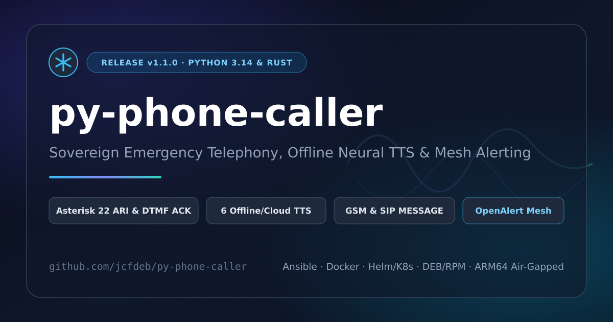
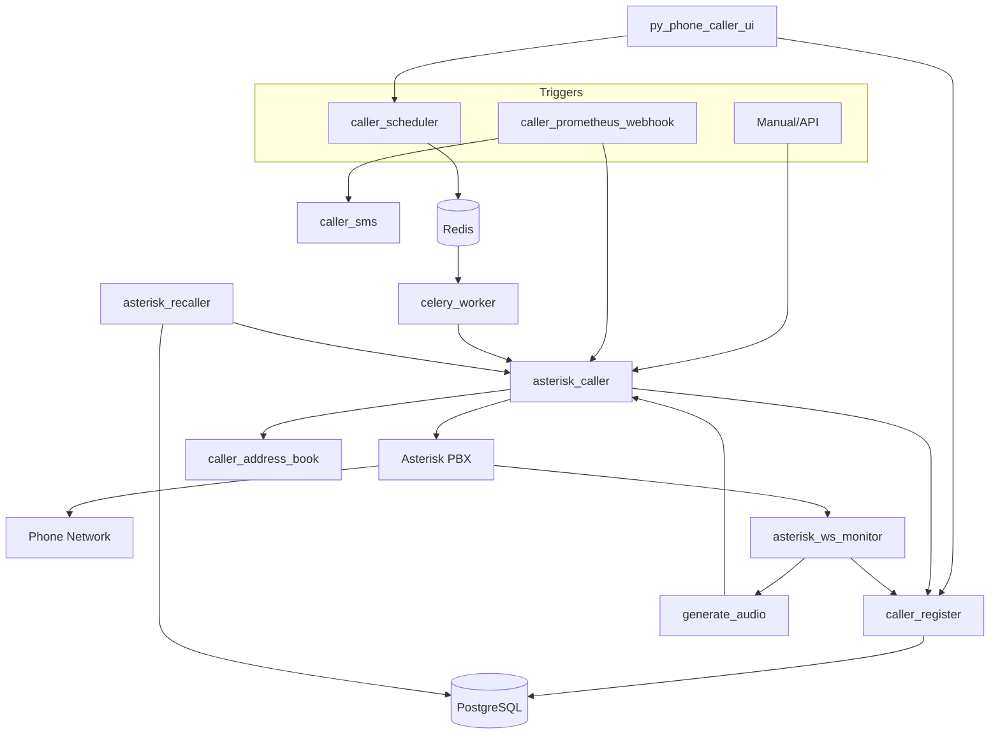

# py-phone-caller & OpenAlert (`v1.1.0`)

<p align="center">
  <a href="https://jcfdeb.github.io/py-phone-caller/">
    
  </a>
</p>

<p align="center">
  <a href="https://jcfdeb.github.io/py-phone-caller/"><strong>🌐 Suite Showcase</strong></a> ·
  <a href="https://jcfdeb.github.io/py-phone-caller/openalert/"><strong>📡 OpenAlert Mesh</strong></a> ·
  <a href="https://jcfdeb.github.io/py-phone-caller/manual/"><strong>📖 Docs Manual</strong></a> ·
  <a href="docs/quickstart-5-minutes.md"><strong>⚡ 5-Minute Quickstart</strong></a> ·
  <a href="https://jcfdeb.github.io/py-phone-caller/manual/api-explorer/"><strong>🔌 OpenAPI 3.0 Explorer</strong></a>
</p>

Sovereign emergency alerting, voice telephony, dual-channel SMS/SIP messaging, and off-grid mesh routing suite for Asterisk-based and air-gapped environments.

[](CHANGELOG.md)
[](https://github.com/jcfdeb/py-phone-caller/actions/workflows/ci.yml)
[](https://github.com/jcfdeb/py-phone-caller/actions/workflows/appsec.yml)
[](https://jcfdeb.github.io/py-phone-caller/)
[](pyproject.toml)
[](src/openalert/Cargo.toml)
[](https://x.com/gladstein/status/2092304843037884677)
[](LICENSE)

> [!WARNING]
> **Security Notice**: This solution is designed to run inside a trusted network segment or air-gapped perimeter.
> Only the Web UI (or the Edge Gateway) should be exposed, and it must be protected by authentication and a reverse proxy.
> All internal microservice ports (`8081`–`8087`, `8090`) must remain private. See [`SECURITY.md`](SECURITY.md).

## Overview

The repository delivers two tightly integrated—yet independently deployable—pillars:

1. **`py-phone-caller` (Python 3.14 + Rust GSM Engine)**: Turns monitoring alerts (*Prometheus Alertmanager, Nagios, Zabbix, Grafana*), scheduled jobs, or manual dispatches into outbound **Asterisk 22 voice calls** (with offline neural TTS and DTMF `4` acknowledgment) and **dual-channel SMS / RFC 3428 SIP `MESSAGE`** notifications (*on-premise USB GSM/LTE modems with always-UCS-2 encoding or Twilio*).
2. **`OpenAlert` (`openalertd`, pure Rust)**: Autonomous store-and-forward edge and mesh router bridging off-grid **LoRa 868 MHz RF**, **BitChat Bluetooth LE**, **`/sos` Wi-Fi Captive Portals** (offline SVG CAPTCHA), and **Nostr (`NIP-ALERT` Kind 30000 & 0xChat NIP-17 E2EE C2)** directly into `py-phone-caller` or standalone webhooks.

## Start Here — Pick Your Deployment Tier

You do **not** need to configure all microservices or optional layers on day one. Every pillar (`py-phone-caller`, `asterisk`, `openalertd`, and `APISIX/Keycloak`) is independently selectable and automated end-to-end:

| Tier | Goal | What Gets Installed | Recommended Guide |
| :--- | :--- | :--- | :--- |
| **Tier 1 — Fast Evaluation** | Try the UI, TTS, and alerting pipeline locally in minutes | 15-container Docker / Podman Compose stack (connects to an existing Asterisk PBX) | **[03. Docker Compose](deploy/docs/03-docker-compose-deployment.md)** |
| **Tier 2 — Single-Node Production / Air-Gapped Appliance** | Turnkey, zero-cloud alerting server on a VM or ARM64 SBC (e.g. Orange Pi 5 Plus) | One Ansible playbook wires Asterisk 22, PostgreSQL, Redis/Valkey, Caddy TLS, all 11 Python services, and optional `openalertd` / USB GSM | **[02. Native Ansible](deploy/docs/02-ansible-deployment.md)** · **[09. ARM64 & Air-Gapped](deploy/docs/09-arm64-appliance-and-airgapped-deployment.md)** |
| **Tier 3 — Cloud-Native & Enterprise SSO** | Kubernetes cluster or Zero-Trust OIDC RBAC + NOC Grafana observability | Helm v3 chart (`GKE`/`k3s`), Apache APISIX gateway, Keycloak OIDC (`admin`/`operator`/`viewer`), Prometheus & Grafana | **[04. Kubernetes & Helm](deploy/docs/04-kubernetes-and-helm-deployment.md)** · **[07. Gateway & Observability](deploy/docs/07-enterprise-gateway-and-observability.md)** |

> [!TIP]
> **Prefer native packages or a custom virtualenv?** See **[05. Native `.deb` & `.rpm` Packages](deploy/docs/05-linux-deb-rpm-deployment.md)** or **[06. PyPI Wheels & Systemd](deploy/docs/06-pypi-and-systemd-deployment.md)**, then prove your installation with the **[10. 12-Gate End-to-End Validation Checklist](deploy/docs/10-end-to-end-installation-validation.md)**.

## Key Features

- **Outbound Voice Calls**: Originated via Asterisk ARI with automated retry and backup escalation logic.
- **Prometheus Alertmanager Integration**: Native webhook supporting call-only, SMS-only, simultaneous, or SMS-before-call escalation.
- **Multi-Engine Neural TTS**: Kokoro-82M, Silero, Piper ONNX, Facebook MMS, AWS Polly, and Google gTTS with dynamic language discovery, speech rate control, and automated model preloading.
- **Dynamic Language & Engine Routing**: Intelligent fallback resolving language aliases and delegating to installed offline models across engines.
- **SMS Delivery**: Dual-backend support for cloud delivery via Twilio API or local air-gapped delivery via on-premise USB GSM/LTE modems (native Rust engine).
- **Scheduling & Priority Queues**: Redis and Celery-backed execution supporting priority queues (P0 emergency routing) and scheduled delivery.
- **Contact & On-Call Rotations**: Multi-tiered address book with time-windowed on-call coverage, priority rankings, and interactive calendar.
- **Multilingual Web UI**: Flask management console with internationalization (`Flask-Babel`), RTL layout support (Arabic, Hebrew), European translations (German, Spanish, French, Italian, English), live TTS audio preview, bulk call acknowledgment, and incident audit reporting.
- **Enterprise Resilience**: Asterisk ARI Circuit Breakers, distributed Redis locks, standardized health/readiness probes, and OpenTelemetry instrumentation.

## Architecture



## Components

| Component | Purpose | Docs |
| --- | --- | --- |
| `asterisk_caller` | Places outbound calls via Asterisk ARI and plays audio. | [README](src/asterisk_caller/README.md) |
| `asterisk_ws_monitor` | Consumes ARI WebSocket events and triggers playback/audio generation. | [README](src/asterisk_ws_monitor/README.md) |
| `asterisk_recaller` | Retries failed or unacknowledged calls and escalates to backups. | [README](src/asterisk_recaller/README.md) |
| `caller_register` | Central registry for call attempts, status, and metadata. | [README](src/caller_register/README.md) |
| `caller_scheduler` | Schedules future calls through Celery tasks. | [README](src/caller_scheduler/README.md) |
| `celery_worker` | Executes queued and scheduled call tasks with priority routing. | [src/README.md](src/README.md) |
| `caller_sms` | SMS notifications via Twilio or on-premise modem backend. | [README](src/caller_sms/README.md) |
| `caller_prometheus_webhook` | Alertmanager-compatible webhook for calls and SMS. | [README](src/caller_prometheus_webhook/README.md) |
| `caller_address_book` | Contact and on-call rotation management. | [README](src/caller_address_book/README.md) |
| `generate_audio` | Multi-engine text-to-speech audio generation with dynamic language discovery and preloading. | [README](src/generate_audio/README.md) |
| `py_phone_caller_ui` | Web UI for operations, scheduling, users, audio preview, and incident audits. | [README](src/py_phone_caller_ui/README.md) |
| `py_phone_caller_utils` | Shared library for config, DB, TTS, SMS, telemetry, and circuit breakers. | [README](src/py-phone-caller-utils/README.md) |
| `openalertd` | Decentralized Nostr (`NIP-ALERT` Kind 30000, NIP-57 Lightning Zap Adapter, 0xChat NIP-17 E2EE C2, optional Embedded Micro-Relay `:8088` — move to `:8089` or disable when co-located with Asterisk ARI), `/sos` Captive Portal, LoRa RF, and BitChat BLE mesh gateway bridging air-gapped field alerts. | [README](src/openalert/README.md) |

## Prerequisites & Requirements (What You Need to Run)

Depending on your environment and the features you plan to enable (outbound voice calls, SMS messaging, local neural TTS vs. cloud TTS, monitoring alerts), here is what you need to run **py-phone-caller**:

### 1. Core System & Compute
- **Linux Operating System**: Debian (`12` / `13 trixie`), Ubuntu (`22.04` / `24.04` / `26.04 LTS`), RHEL / Rocky Linux (`9` / `10`), AlmaLinux (`9` / `10`), or openSUSE (AMD64 & ARM64 `aarch64`).
- **Hardware Resources**:
  - **Minimum**: 2 vCPUs, 4 GB RAM, 20 GB SSD storage.
  - **Recommended**: 4+ vCPUs, 8 GB RAM (for fast neural speech synthesis), 50 GB SSD storage.
- **Runtime Environment**:
  - **Containerized**: Docker Engine 24+ with Docker Compose v2 (`docker compose`), **OR** Podman 4.5+ with Podman Compose (`podman compose`).
  - **Native Systemd**: Python 3.14+ managed via [uv](https://docs.astral.sh/uv/) and Systemd.

### 2. Telephony & Infrastructure (Required for Phone Calls)
- **Asterisk PBX (`v18+` / `v20+` / `v22`) or FreePBX**:
  - **SIP / PJSIP Trunk**: An active SIP trunk or VoIP gateway (e.g. Twilio Elastic SIP Trunking, local telecom SIP provider, or GSM/PSTN hardware gateway) capable of placing outbound calls to landlines and mobile phones.
  - **Asterisk REST Interface (ARI)**: Enabled in `ari.conf` with HTTP/WebSocket support (default port `8088`), an ARI user (default: `py-phone-caller`), and password.
  - **Stasis Dialplan**: A context configured in `extensions.conf` to direct outbound calls into the `py-phone-caller` Stasis application.
- **PostgreSQL Database (`v16+` / `v17` / `v18`)**:
  - Stores call logs, address book contacts, on-call schedules, SMS audit history, and web UI user accounts.
  - Relational schema tables and migrations are automatically initialized and managed via Piccolo ORM by `caller_register`.
- **Redis (`v7+` / `v8`) or Valkey (`v8+`)**:
  - In-memory message broker used by Celery for asynchronous call scheduling, priority queues, and distributed locking.

### 3. Text-to-Speech (TTS) Engines: Local vs. Cloud
`generate_audio` converts alert text messages into Asterisk-compliant 8 kHz mono WAV audio files. You can choose between 100% offline local neural TTS or cloud-hosted synthesis:

| TTS Engine | Mode | What You Need | Key Benefits & Notes |
| :--- | :--- | :--- | :--- |
| **Kokoro-82M** *(Default & Recommended)* | **Local / Offline** | • CPU/RAM for inference<br>• Model weights (`kokoro-v1_0.pth` ~320MB) & voice embeddings cached in `pre_trained_models/kokoro_tts`<br>• `ffmpeg` for 8 kHz audio encoding | **Zero cloud accounts needed.** Runs 100% locally on CPU in air-gapped environments. Natural human-like speech. |
| **Silero TTS** | **Local / Offline** | • PyTorch runtime & weights (`v3_<lang>.pt` ~50MB) cached in `pre_trained_models/silero_tts`<br>• `ffmpeg` for 8 kHz audio resampling | **Zero cloud accounts needed.** Ultra-compact, highly reliable offline neural TTS with multi-language speaker models (English, Spanish, German, French, Russian, Indic). Runs efficiently on low-resource hardware. |
| **Piper ONNX** | **Local / Offline** | • ONNX voice model files (`.onnx` + `.onnx.json`) in `pre_trained_models/piper_tts`<br>• `ffmpeg` | Ultra-fast, lightweight neural speech synthesizer designed for local devices. |
| **Facebook MMS** | **Local / Offline** | • Hugging Face MMS model checkpoint (`facebook/mms-tts-<lang>`)<br>• `ffmpeg` | Supports over 1,000+ languages completely offline. |
| **AWS Polly** | **Cloud / Online** | • **Active AWS Account**<br>• AWS credentials (`AWS_ACCESS_KEY_ID`, `AWS_SECRET_ACCESS_KEY`, `aws_polly_region_name`)<br>• IAM permission: `polly:SynthesizeSpeech`<br>• Outbound Internet connectivity | Cloud-managed TTS service with diverse multilingual voices. |
| **gTTS** | **Cloud / Online** | • Outbound Internet access to Google Translate TTS | Lightweight cloud fallback for quick testing without API keys. |

### 4. SMS Dispatch Backends: Hardware USB Modem vs. Cloud
`caller_sms` provides two distinct SMS dispatch backends:

| SMS Backend | Mode | What You Need | Configuration & Details |
| :--- | :--- | :--- | :--- |
| **On-Premise Hardware Modem** (`on_premise`) | **Local / Offline** | • **Physical USB GSM / 3G / 4G LTE Modem** connected to the host.<br>• **Active SIM Card** with an SMS texting plan.<br>• Serial device nodes (e.g. `/dev/ttyUSB0`..`/dev/ttyUSB3`) accessible by the service user (`dialout` group).<br>• Compiled native Rust engine (`rust_engine`). | Set `caller_sms_carrier = "on_premise"` in `settings.toml`. **Zero cloud accounts needed.** High-availability modem pool with round-robin or failover strategy. Fully resilient when internet is down. |
| **Twilio Cloud SMS** (`twilio`) | **Cloud / Online** | • **Active Twilio Account**.<br>• Twilio Account SID (`twilio_account_sid`), Auth Token (`twilio_auth_token`), and an SMS-enabled sender number (`twilio_sms_from`).<br>• Outbound Internet access to `api.twilio.com`. | Set `caller_sms_carrier = "twilio"` in `settings.toml`. **Zero hardware required.** Immediate cloud dispatch worldwide. |

#### Hardware USB GSM Modem Inspection Example (`lsusb -tv`)
When using the on-premise SMS engine with a USB cellular modem (e.g., Qualcomm, Option, Huawei, SIMCom, Quectel devices), verify that the Linux kernel attaches the `option` or `qcserial` serial driver:

```text
operator@alert-host:~> lsusb -tv
/:  Bus 05.Port 1: Dev 1, Class=root_hub, Driver=xhci_hcd/4p, 480M
    |__ Port 1: Dev 2, If 0, Class=Hub, Driver=hub/4p, 480M
        ID 2109:2813 VIA Labs, Inc. VL813 Hub
        |__ Port 4: Dev 7, If 0, Class=Vendor Specific Class, Driver=option, 480M
            ID 1e0e:9001 Qualcomm / Option
        |__ Port 4: Dev 7, If 1, Class=Vendor Specific Class, Driver=option, 480M
            ID 1e0e:9001 Qualcomm / Option
        |__ Port 4: Dev 7, If 2, Class=Vendor Specific Class, Driver=option, 480M
            ID 1e0e:9001 Qualcomm / Option
        |__ Port 4: Dev 7, If 3, Class=Vendor Specific Class, Driver=option, 480M
            ID 1e0e:9001 Qualcomm / Option
```

The native Rust engine automatically communicates over the AT command interface (`/dev/ttyUSB*`) with full UTF-8 / UCS-2 character support and active duplicate suppression.

### 5. Monitoring System Integrations (Optional)
- **Prometheus Alertmanager**: Webhook receiver configured to POST to `http://<host>:8084/alert`.
- **Nagios Core / XI**: Event handler script (`assets/scripts/nagios/nagios_event_handler_call.sh`) configured in commands.
- **Zabbix Server / Proxy**: Alert script (`assets/scripts/zabbix/zabbix_alert_call.sh`) configured in Media Types.

## Deployment Options (`deploy/docs/`)

All deployment guides are centralized under **[`deploy/docs/README.md`](deploy/docs/README.md)** with verified, step-by-step installation and health-check instructions for every environment:

- **[Deployment Documentation Hub (`deploy/docs/README.md`)](deploy/docs/README.md)**: Master comparison matrix and quick navigation across all deployment pillars.
- **[01. Architecture, Prerequisites & Configuration Reference](deploy/docs/01-architecture-and-prerequisites.md)**: Service port map (`:8081`–`:8087`, `:5000`, `:8090`), Asterisk ARI dialplan setup, `settings.toml`, `.secrets.toml`, TTS models, and USB GSM modems.
- **[02. Native Ansible Deployment Guide](deploy/docs/02-ansible-deployment.md)** ([`deploy/ansible/`](deploy/ansible/README.md)): Independently select OpenAlert, Python, and Asterisk (`standard` / `enterprise`, `online` / `airgapped`, plus `adopt.yml`, `backup.yml`, `restore.yml`, `rollback.yml`).
- **[03. Docker & Docker Compose Deployment Guide](deploy/docs/03-docker-compose-deployment.md)** ([`deploy/compose/`](deploy/compose/README.md)): Full 15-container stack, USB GSM/LoRa/BLE hardware passthrough (`docker-compose.hardware.yml`), and APISIX/Keycloak gateway overlay (`docker-compose.gateway.yml`).
- **[04. Kubernetes & Helm v3 Deployment Guide](deploy/docs/04-kubernetes-and-helm-deployment.md)** ([`deploy/helm/py-phone-caller/`](deploy/helm/py-phone-caller/README.md) & [`deploy/k8s/`](deploy/k8s/README.md)): Parameterized Helm v3 chart (`py-phone-caller-1.1.0.tgz`) and 43-resource Kustomize manifests.
- **[05. Native Linux Packages (`.deb` & `.rpm`) Guide](deploy/docs/05-linux-deb-rpm-deployment.md)** ([`deploy/packaging/linux/`](deploy/packaging/linux/README.md)): Native `apt` (`.deb`) and `dnf` (`.rpm`) installation for Debian/Ubuntu and RHEL/Rocky/AlmaLinux.
- **[06. Python Wheels (`PyPI`) & Systemd Deployment Guide](deploy/docs/06-pypi-and-systemd-deployment.md)** ([`deploy/packaging/pypi/`](deploy/packaging/pypi/README.md) & `deploy/systemd/`): Installing `py-phone-caller[all]==1.1.0` into a custom virtual environment with `systemd` units.
- **[07. Enterprise Gateway (`APISIX` + `Keycloak`) & Observability](deploy/docs/07-enterprise-gateway-and-observability.md)** ([`docs/ENTERPRISE_GATEWAY_AND_IAM_GUIDE.md`](docs/ENTERPRISE_GATEWAY_AND_IAM_GUIDE.md) & [`deploy/dashboards/`](deploy/dashboards/README.md)): Zero-Trust OIDC SSO, 3-tier RBAC, Prometheus scraping, and turnkey Grafana dashboard.
- **[08. Release Packaging & Verification Guide](deploy/docs/08-release-packaging.md)** ([`deploy/packaging/`](deploy/packaging/README.md)): Reproducibly building all 33 distributable release archives/packages in `dist/` via `deploy/packaging/build_all_releases.py`.
- **[09. ARM64 Appliance & Air-Gapped Deployment Guide](deploy/docs/09-arm64-appliance-and-airgapped-deployment.md)**: All-in-one Orange Pi 5 Plus (RK3588 `aarch64`) deployment in both `online` and 100% `airgapped` modes (`unshare --net`), signed `file:` APT mirror, USB GSM SIM7600E-H, and local SIP softphone verification.
- **[10. End-to-End Installation Validation Checklist](deploy/docs/10-end-to-end-installation-validation.md)**: Copy-pasteable 12-Gate verification procedure covering systemd, private listeners, DB/Redis, Asterisk ARI/Stasis, `openalertd`, Rust SMS, Piper TTS, strict-TLS Web UI + `/api/docs`, air-gap isolation, idempotency, and cold reboot recovery.
- **OpenAlert Nostr Alert Specification (`NIP-ALERT`)**: [`docs/openalert/NIP-ALERT.md`](docs/openalert/NIP-ALERT.md)

## Quick Start

Pick one path (see **[`deploy/docs/README.md`](deploy/docs/README.md)** for the full comparison matrix across all deployment pillars):

### Option A: Docker Compose (fastest, external Asterisk required)

For the full walkthrough including hardware USB GSM/LoRa/BLE passthrough and the Enterprise APISIX/Keycloak overlay, see **[03. Docker & Docker Compose Deployment Guide](deploy/docs/03-docker-compose-deployment.md)**. *(Note: `deploy/compose/docker-compose.yml` launches the full 15-container platform including the Web UI on `:5000`, whereas the root `docker-compose.yml` launches only a lightweight 3-container `openalertd` + webhook + Piper TTS edge bridge.)*

1. Configure Asterisk access used by the containers:
   - `src/config/settings.toml`: set `[commons] asterisk_host`, `asterisk_user`, and `asterisk_web_port` if different.
   - `src/config/.secrets.toml`: set `[commons] asterisk_pass` to your ARI password.
   - If Asterisk runs on the Docker host, use `asterisk_host = "host.containers.internal"`.
   - Asterisk ARI/dialplan prerequisites: **[01. Architecture & Prerequisites (§3)](deploy/docs/01-architecture-and-prerequisites.md#3-asterisk-pbx-prerequisites-ari-stasis--dialplan)**.
2. Create the Compose environment files:
   ```bash
   uv run python assets/scripts/config/toml_to_dynaconf_env.py \
     --input src/config/settings.toml \
     --output deploy/compose/env/py-phone-caller.env

   uv run python assets/scripts/config/toml_to_dynaconf_env.py \
     --ignore-missing \
     --input src/config/.secrets.toml \
     --output deploy/compose/env/py-phone-caller.secrets.env

   cd deploy/compose
   cat > .env <<'EOF'
   POSTGRES_PASSWORD=change_me
   CADDY_DOMAIN_NAME=py-phone-caller.lan
   UI_USER_RESET_PASSWORD=false
   EOF
   ```
3. Build and start the stack:
   ```bash
   docker compose build
   docker compose up -d
   ```
4. Verify services are healthy:
   ```bash
   docker compose ps
   ```
5. Open the UI and retrieve the admin password:
   - UI: `http://localhost:5000` (or the Caddy HTTPS domain you set).
   - Admin email defaults to `admin@py-phone-caller.link` (change via `ui_admin_user`).
   - If `UI_USER_RESET_PASSWORD=true`, the first-run password is generated and logged by `py_phone_caller_ui`:
     ```bash
     docker compose logs -f py_phone_caller_ui
     ```

### Option B: Modular native Ansible installation

Follow **[02. Native Ansible Deployment Guide](deploy/docs/02-ansible-deployment.md)** (or **[09. ARM64 Appliance & Air-Gapped Deployment Guide](deploy/docs/09-arm64-appliance-and-airgapped-deployment.md)** for SBC/air-gapped hosts) using a separate reviewed inventory and Vault-protected secrets. Set all three component selectors explicitly; the managed host determines artifact architecture, not the controller.

```bash
cd deploy/ansible
ansible-galaxy collection install -r requirements.yml -p "$PWD/.collections"
ansible-playbook -i /secure/inventory/hosts.yml site.yml --ask-vault-pass
```

For an all-in-one deployment select both `stack_deploy_py_phone_caller` and `stack_deploy_asterisk`; OpenAlert remains independently selectable. Internal listeners, local/external dependencies and hardware access must be configured for the target. Selecting a lightweight TTS engine does not change the locked workspace dependency installation.

Legacy [combined](deploy/ansible/deploy_all/README.md), [Python](deploy/ansible/on-vm_py-phone-caller/README.md), and [PBX](deploy/ansible/asterisk_py-phone-caller/README.md) entry points remain available for backward compatibility. Do not deploy the repository's live-site inventory to a new host. Consult the [support matrix](deploy/ansible/docs/support-matrix.md) before treating a platform or hardware profile as qualified, and verify your installation with **[10. End-to-End Installation Validation Checklist](deploy/docs/10-end-to-end-installation-validation.md)**.

## Configuration

- Primary settings file: `src/config/settings.toml` (see **[01. Architecture & Configuration (§4)](deploy/docs/01-architecture-and-prerequisites.md#4-configuration--secrets-contract-settingstoml--secretstoml)** for the per-deployment path table across Ansible, `.deb`/`.rpm`, PyPI/systemd, and containers)
- Local runs can override config location with `CALLER_CONFIG_DIR` or `CALLER_CONFIG`
- Container runs should inject generated `DYNACONF_*` env files instead of baking config files into images
- Core dependencies: Asterisk PBX with ARI enabled, PostgreSQL (`16+` / `17` / `18`), Redis (`7+` / `8`) or Valkey (`8+`)
- Optional integrations: Twilio credentials, USB GSM/LoRa/BLE hardware, and TTS model downloads

## Project Status

- **v1.1.0 Deployment Pillars Qualified**: Native Ansible (Debian 13, Ubuntu 26.04 LTS, Rocky Linux 10 `SELinux Enforcing`, AlmaLinux 10 `SELinux Enforcing`, plus physical ARM64 Orange Pi 5 Plus in both `online` and 100% `airgapped` modes), Docker Compose (+ APISIX/Keycloak Gateway), Kubernetes & Helm v3 (`GKE` & `k3s` with `EndpointSlice`), native `.deb`/`.rpm` packages, and PyPI/systemd — see **[`deploy/docs/README.md`](deploy/docs/README.md)** and the [support matrix](deploy/ansible/docs/support-matrix.md).
- Core voice calling, DTMF acknowledgment (`4` key), dual-channel SMS/SIP `MESSAGE`, and OpenAlert mesh flows are verified end-to-end.
- Operating the stack in production requires Asterisk/FreePBX and Linux administration knowledge.

## Documentation

- **[5-Minute Local Quickstart (Zero VoIP Trunk Needed)](docs/quickstart-5-minutes.md)** - Try live voice calls, DTMF `4` acknowledgment, and SIP `MESSAGE` alerts locally with Linphone on extension `1000`.
- **[Centralized Deployment Documentation Hub (`deploy/docs/`)](deploy/docs/README.md)** - Complete modular step-by-step installation guides across Ansible, Docker Compose, Kubernetes/Helm, DEB/RPM, PyPI/systemd, ARM64/Air-Gapped appliances, and 12-Gate validation.
- **[Master Documentation Library](docs/README.md)** - Comprehensive documentation map, architectural guides, and operational manuals.
- **[Changelog (`CHANGELOG.md`)](CHANGELOG.md)** - Unified version history (`v1.1.0`, `v1.0.1`, `v1.0.0`, `v0.0.2`).
- **[Release 1.0.1 Enhancement Report](docs/1.0.1-release.md)** - Deep-dive notes on the Strategy-pattern TTS engine & RTL UI.
- **[Architecture & Call Flows Guide](docs/architecture-and-call-flows.md)** - End-to-end call lifecycle, DTMF acknowledgment (`4` key), dual-channel SMS/SIP `MESSAGE` routing, always-UCS-2 GSM SMS, retry loops, and OpenAlert mesh bridge.
- **[Services & Endpoints Reference](docs/services-and-endpoints.md)** & **[Interactive OpenAPI 3.0 Explorer](docs/api-explorer.md)** - Complete REST API specification across all 9 services, `/ready` probes, OpenAPI `/docs`, and Piccolo ORM schemas.
- **[Hardware & Sovereign Field-Kit BOM Guide](docs/hardware-and-field-kit-bom.md)** - Tested ARM64 SBCs, USB 4G/LTE AT modems (`udev` rules), LoRa 868/915 MHz radios, BLE adapters, and SIP phones.
- **[Day-2 SRE Runbook & Self-Monitoring Rules](docs/sre-day2-operations-and-watchdog.md)** - Ready-to-use Prometheus watchdog alerting rules ([`prometheus-alerting-rules.yml`](deploy/dashboards/prometheus-alerting-rules.yml)), online backups, and zero-downtime secret rotation.
- **[Enterprise Gateway & Keycloak SSO Guide](docs/ENTERPRISE_GATEWAY_AND_IAM_GUIDE.md)** - Automated and manual guide for Apache APISIX & Keycloak OIDC.
- **[Asterisk PBX Configuration & Examples](docs/asterisk-pbx-configuration-guide.md)** - Complete `/etc/asterisk/*.conf` examples (ARI, PJSIP VoIP trunks, local softphone extension `1000`, Stasis + DTMF `4` ACK dialplan, `modules.conf`, and SELinux).
- **[FreePBX & Asterisk GUI Setup Guide](docs/freepbx-asterisk-setup-guide.md)** - Visual FreePBX walkthrough plus native Asterisk 22 Ansible automation & local SIP Extension `1000`.
- **[OpenAlert Architecture & Nostr Alerting (`NIP-ALERT`)](docs/openalert/README.md)** - Decentralized LoRa RF, BitChat BLE, `/sos` Captive Portal, and Nostr bridge (`openalertd`).
- **[Web UI Operator Tour](docs/web-ui-tour/README.md)** - Visual walkthrough of the multilingual Web Management UI, calls table, SMS dashboard, and on-call calendars.
- **[OpenTelemetry & Observability Guide](docs/opentelemetry-guide.md)** - Metrics scraping (`/metrics`), health/readiness probes (`/health`, `/ready`), and distributed tracing ([Tempo](docs/tempo_traces.md)).
- **[UV Workspace & Packaging Guide](docs/uv-migration-and-workspace-guide.md)** - Python 3.14 UV workspace, Maturin Rust SMS engine, dependency management, and container builds.
- **[AppSec, Supply-Chain & Non-Regression Guide](docs/appsec-and-supply-chain-guide.md)** - Contributor onboarding, `Taskfile.yml` security tiers (`sec:fast`, `sec:ci`, `sec:release`), non-regression checks (`verify:all`), and transactional CVE auto-rollback (`sec:fix:py`, `sec:fix:rust`).
- **[Archived Documentation Index](docs/archive/README.md)** - Preserved pre-release, historical audit, and superseded legacy guides.
- **[Security Policy (`SECURITY.md`)](SECURITY.md)**, **[Contributing Guide (`CONTRIBUTING.md`)](CONTRIBUTING.md)** & **[Code of Conduct (`CODE_OF_CONDUCT.md`)](CODE_OF_CONDUCT.md)**.
- **Licensing**: `py-phone-caller` is licensed under [`LICENSE`](LICENSE) (BSD 3-Clause); `openalertd` (`src/openalert/`) is dual-licensed under [`MIT`](src/openalert/LICENSE-MIT) OR [`Apache-2.0`](src/openalert/LICENSE-APACHE).

## Further Readings

- [Source architecture overview](src/README.md) - High-level tour of the `src/` microservices and how they fit together.
- [Asterisk Caller](src/asterisk_caller/README.md) - HTTP service that places outbound calls and plays audio via Asterisk ARI.
- [Asterisk Recaller](src/asterisk_recaller/README.md) - Background worker that retries failed calls and escalates to backup contacts.
- [Asterisk WS Monitor](src/asterisk_ws_monitor/README.md) - WebSocket listener for ARI events that triggers audio generation and playback.
- [Caller Address Book](src/caller_address_book/README.md) - Contact and on-call rotation service with CSV import/export.
- [Caller Prometheus Webhook](src/caller_prometheus_webhook/README.md) - Alertmanager webhook that turns Prometheus alerts into calls and SMS.
- [Caller Register](src/caller_register/README.md) - Call registry service for call attempts, statuses, and scheduled calls.
- [Caller Scheduler](src/caller_scheduler/README.md) - Celery-backed scheduler for future call execution.
- [Caller SMS](src/caller_sms/README.md) - SMS gateway service with Twilio and on-premise modem backends.
- [Generate Audio](src/generate_audio/README.md) - Text-to-speech service for generating call audio files.
- [py-phone-caller-utils](src/py-phone-caller-utils/README.md) - Shared utility library for config, DB, TTS, SMS, and telemetry helpers.
- [py_phone_caller_ui](src/py_phone_caller_ui/README.md) - Flask web UI for calls, schedules, users, and WS events.
- [Modular Ansible Deployment Guide](deploy/docs/02-ansible-deployment.md) ([canonical role reference](deploy/ansible/README.md)) - Turnkey native installation across AMD64 and ARM64 (`standard`/`enterprise`, `online`/`airgapped`).
- [Docker & Docker Compose Guide](deploy/docs/03-docker-compose-deployment.md) ([compose manifests](deploy/compose/README.md)) - Containerized full-stack deployment with hardware and gateway overlays.
- [Kubernetes & Helm v3 Guide](deploy/docs/04-kubernetes-and-helm-deployment.md) ([Helm chart](deploy/helm/py-phone-caller/README.md) / [Kustomize](deploy/k8s/README.md)) - Cloud-native and k3s deployment.
- *Compatibility Ansible entry points*: [deploy_all](deploy/ansible/deploy_all/README.md), [Asterisk role](deploy/ansible/asterisk_py-phone-caller/README.md), [py-phone-caller role](deploy/ansible/on-vm_py-phone-caller/README.md).
