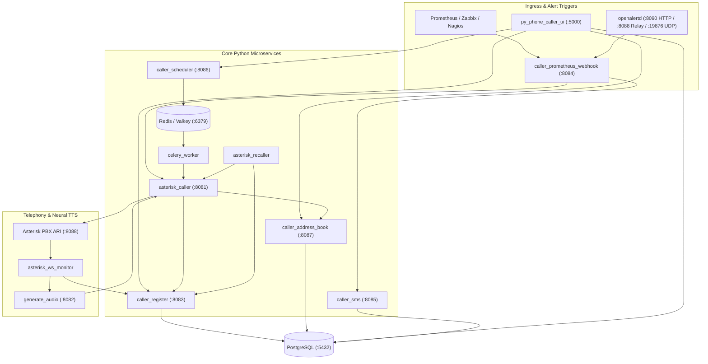

# 01. Architecture, Prerequisites & Configuration Reference

Before running any installer, use this reference to verify your infrastructure prerequisites, understand the microservice topology and port assignments, and prepare your configuration and secret values.

---

## 1. Suite Architecture & Microservice Inventory

The platform consists of **11 Python microservices** (sharing `py_phone_caller_utils`) plus the **`openalertd` Rust daemon**, backed by **PostgreSQL**, **Redis / Valkey**, and **Asterisk PBX**.



### Canonical Service & Port Reference

Every deployment method (Ansible, Docker Compose, Kubernetes, Helm, RPM/DEB, and PyPI) uses the same default internal ports and health probe endpoints:

| Service / Binary | CLI Entrypoint | Default Port | Health Probe | Responsibility |
| :--- | :--- | :--- | :--- | :--- |
| `asterisk_caller` | `ppc-asterisk-caller` | `8081/tcp` | `GET /health` | Originates outbound calls via Asterisk ARI and streams synthesized WAV audio |
| `generate_audio` | `ppc-generate-audio` | `8082/tcp` | `GET /health` | Synthesizes 8 kHz mono WAV audio via Piper, Kokoro, Silero, MMS, Polly, or gTTS |
| `caller_register` | `ppc-caller-register` | `8083/tcp` | `GET /health` | Central call/event registry; initializes & migrates PostgreSQL schema via Piccolo ORM |
| `caller_prometheus_webhook` | `ppc-caller-prometheus-webhook` | `8084/tcp` | `GET /health` | Receives Prometheus Alertmanager / OpenAlert webhooks and dispatches calls/SMS |
| `caller_sms` | `ppc-caller-sms` | `8085/tcp` | `GET /health` | Dispatches SMS via Twilio API or local USB GSM/LTE modems (`rust_sms_engine`) |
| `caller_scheduler` | `ppc-caller-scheduler` | `8086/tcp` | `GET /health` | Schedules future and recurring calls into Redis for Celery execution |
| `caller_address_book` | `ppc-caller-address-book` | `8087/tcp` | `GET /health` | Manages contacts, priority rankings, and time-windowed on-call calendars |
| `py_phone_caller_ui` | `ppc-ui` | `5000/tcp` | `GET /health` | Multilingual Flask operator console, audio previewer, and incident audit viewer |
| `asterisk_ws_monitor` | `ppc-asterisk-ws-monitor` | *(worker)* | Process / systemd | Connects to Asterisk ARI WebSocket (`Stasis`), triggers TTS playback & DTMF capture |
| `asterisk_recaller` | `ppc-asterisk-recaller` | *(worker)* | Process / systemd | Polls `caller_register` for unacknowledged calls and triggers retries or backup escalation |
| `celery_worker` | `ppc-celery-worker` | *(worker)* | Process / systemd | Executes queued priority (`P0`) and scheduled call jobs from Redis |
| `openalertd` | `/usr/local/bin/openalertd` | `8090/tcp` (`HTTP`)<br>`8088/tcp` (`Nostr`)<br>`19876/udp` (`Peer`) | `GET /health`<br>`GET /api/v1/status` | Decentralized Nostr (`NIP-ALERT`), Captive Portal (`/sos`), LoRa RF, and BLE mesh daemon |

> [!WARNING]
> **Port `8088` Co-Location Note**: Both Asterisk's built-in HTTP/ARI server and `openalertd`'s embedded Nostr Micro-Relay default to port `8088`. When running Asterisk and `openalertd` on the **same host** (as in the Ansible combined topology), bind `openalertd`'s relay to a distinct port (e.g., `127.0.0.1:8089` or disable `[relay]` if unused) so it does not collide with Asterisk ARI on `8088`.

---

## 2. System & Infrastructure Requirements

### Compute & Operating System
- **Supported Linux Distributions**:
  - **Debian 13 (`trixie`)** or **Debian 12 (`bookworm`)**
  - **Ubuntu 26.04 LTS (`resolute`)** or **Ubuntu 24.04 LTS (`noble`)**
  - **Rocky Linux 10.2 / 9**, **RHEL 10 / 9**, or **AlmaLinux 10 / 9** (`SELinux Enforcing` supported)
- **Hardware Sizing**:
  - **Minimum** (Piper TTS or Cloud TTS): 2 vCPUs, 4 GB RAM, 20 GB SSD.
  - **Recommended** (Kokoro-82M / Multi-Engine Neural TTS or Enterprise Gateway): 4 vCPUs, 8–16 GB RAM, 50–100 GB SSD.
- **System Dependencies**:
  - `ffmpeg` (required on hosts running `generate_audio` to resample neural TTS output to Asterisk-compatible `8000 Hz` mono WAV).
  - `espeak-ng` (required when using `kokoro_tts` phonemization).
  - **Python 3.14+** (for native systemd, PyPI, or DEB/RPM deployments).

### Data Stores
1. **PostgreSQL (`16+` or `17+` recommended)**:
   - Database name: `py_phone_caller` (default)
   - User: `py_phone_caller` (default)
   - You do **not** need to run SQL migrations manually: when `caller_register` starts, it automatically creates and migrates all required tables (`calls`, `contacts`, `on_call_schedules`, `sms_logs`, `users`, etc.).
2. **Redis (`7+` / `8+`) or Valkey (`8+`)**:
   - Used as the Celery message broker (`redis://<host>:6379/7` by default) and distributed lock store.

---

## 3. Asterisk PBX Prerequisites (ARI, Stasis & Dialplan)

If you use the **[Native Ansible Installer](02-ansible-deployment.md)** with `stack_deploy_asterisk: true`, Ansible installs and configures Asterisk automatically.

If you connect `py-phone-caller` to an **existing/external Asterisk or FreePBX server** (Docker Compose, Kubernetes, Helm, or DEB/RPM), ensure your Asterisk server has:

1. **HTTP Server Enabled (`/etc/asterisk/http.conf`)**:
   ```ini
   [general]
   enabled = yes
   bindaddr = 0.0.0.0 ; or your private management IP
   bindport = 8088
   ```
2. **ARI Enabled (`/etc/asterisk/ari.conf`)**:
   ```ini
   [general]
   enabled = yes
   pretty = yes

   [py-phone-caller]
   type = user
   read_only = no
   password = YOUR_STRONG_ARI_PASSWORD
   ```
3. **Stasis Dialplan & DTMF Acknowledgment (`/etc/asterisk/extensions.conf`)**:
   When `asterisk_caller` originates a call, it drops the answered channel into the `py-phone-caller` Stasis application (`context = "py-phone-caller"`, `extension = "3216"` by default), and when the callee presses `1` (or your configured DTMF digit), Asterisk notifies `caller_register`:
   ```ini
   [py-phone-caller]
   exten => 3216,1,NoOp(py-phone-caller outbound alert call)
    same => n,Answer()
    same => n,Stasis(py-phone-caller)
    same => n,Hangup()
   ```
4. **Audio Playback Access**:
   `asterisk_ws_monitor` requests `generate_audio` (`:8082`) to synthesize the alert WAV file and instructs Asterisk ARI to play `sound:http://<generate_audio_host>:8082/audio/<file>.wav` (or local shared volume path). Ensure Asterisk can reach `generate_audio:8082` over HTTP or shares the audio directory.

---

## 4. Configuration & Secrets Contract (`settings.toml` & `.secrets.toml`)

All 11 Python services load their configuration via **Dynaconf** using `src/py-phone-caller-utils/py_phone_caller_utils/config.py`.

### How Services Locate Configuration (`get_config_dir()`)
Configuration files are resolved in the following priority order:
1. Explicit `CALLER_CONFIG` environment variable (`export CALLER_CONFIG=/path/to/settings.toml`).
2. Explicit `CALLER_CONFIG_DIR` environment variable (`export CALLER_CONFIG_DIR=/etc/py-phone-caller`).
3. Relative `./config/settings.toml`, `./py-phone-caller/config/settings.toml` (production layout), or `./src/config/settings.toml` (local dev layout) from the working directory.
4. System fallback `/etc/py-phone-caller/settings.toml` (used automatically by `.deb` and `.rpm` packages).

In addition, **any setting** in `settings.toml` or `.secrets.toml` can be overridden via environment variables using the pattern:
```text
DYNACONF_<SECTION>__<KEY>=<value>
```
For example:
- `[commons] asterisk_host` $\rightarrow$ `DYNACONF_COMMONS__ASTERISK_HOST`
- `[database] db_password` $\rightarrow$ `DYNACONF_DATABASE__DB_PASSWORD`
- `[py_phone_caller_ui] ui_admin_password` $\rightarrow$ `DYNACONF_PY_PHONE_CALLER_UI__UI_ADMIN_PASSWORD`

### Required Secrets Checklist (`.secrets.toml`)
Never commit real secrets to Git. Whether you provide `.secrets.toml` on disk, Kubernetes `Secret`, Helm `--set secrets.*`, or Ansible Vault, you must configure these keys:

```toml
[commons]
# Password matching the [py-phone-caller] user in Asterisk's /etc/asterisk/ari.conf
asterisk_pass = "REPLACE_WITH_ARI_PASSWORD"

[database]
# PostgreSQL password for db_user (default user: py_phone_caller)
db_password = "REPLACE_WITH_POSTGRES_PASSWORD"

[caller_sms]
# Required only when caller_sms_carrier = "twilio" (leave empty "" for on_premise USB GSM modem)
twilio_account_sid = ""
twilio_auth_token = ""

[py_phone_caller_ui]
# Random 32+ character string used to sign Flask session cookies
ui_secret_key = "REPLACE_WITH_RANDOM_SESSION_SECRET"
# Initial bootstrap password for ui_admin_user (default: admin@py-phone-caller.link)
ui_admin_password = "REPLACE_WITH_ADMIN_PASSWORD"
```

---

## 5. Choosing Your TTS Engine & SMS Backend

### Text-to-Speech (`[generate_audio] tts_engine`)
- **`piper_tts`** *(Fastest offline CPU synthesis, default in Docker/K8s/Helm)*: Uses ONNX voice models in `pre_trained_models/piper_tts`. Low RAM (~200 MB), sub-second synthesis on 2 vCPUs.
- **`kokoro_tts`** *(Highest natural quality offline neural TTS)*: Uses `kokoro-v1_0.pth` (~320 MB) + `espeak-ng`. Recommended on hosts with 4+ vCPUs and 8+ GB RAM.
- **`silero_tts` / `mms_tts`**: Offline PyTorch/HuggingFace multi-language models.
- **`aws_polly` / `gtts`**: Online cloud synthesis (requires internet access; `aws_polly` requires AWS credentials).

### SMS Backend (`[caller_sms] caller_sms_carrier`)
- **`twilio`**: Cloud delivery via Twilio REST API (`twilio_account_sid`, `twilio_auth_token`, `twilio_sms_from`).
- **`on_premise`**: Air-gapped hardware delivery via USB GSM/3G/4G LTE modems (`/dev/ttyUSB0`..`/dev/ttyUSB3`) powered by the native Rust `rust_sms_engine` extension. Requires the service user (`py-phone-caller`) to belong to the `dialout` group.
