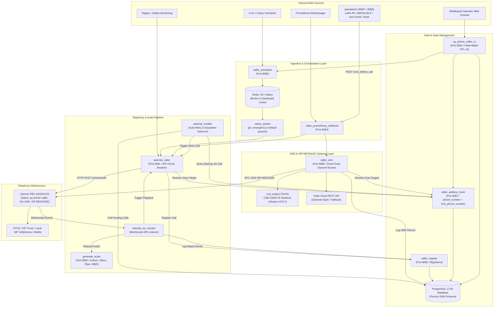
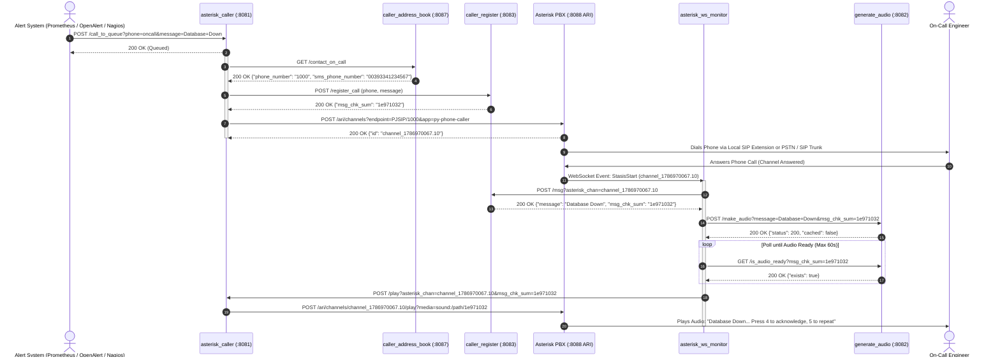
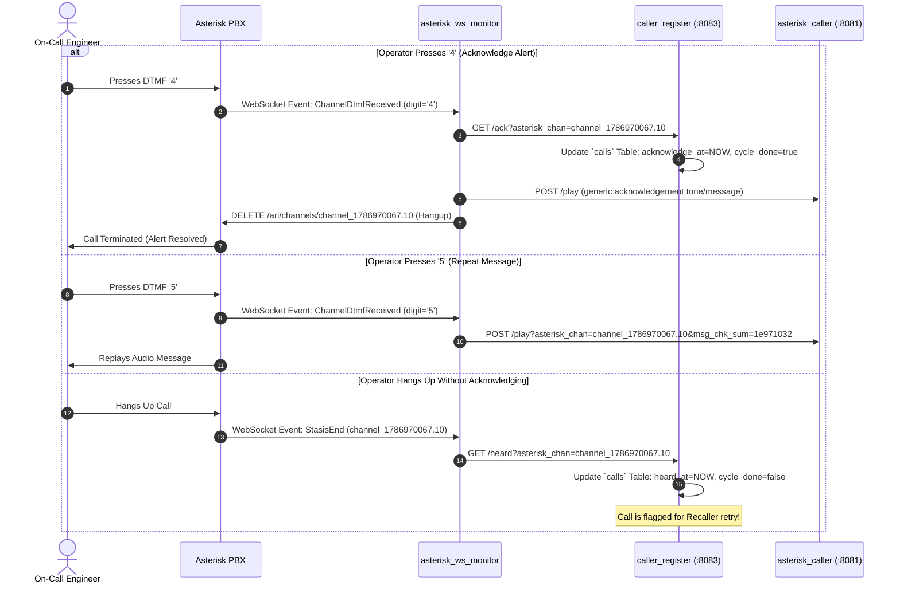
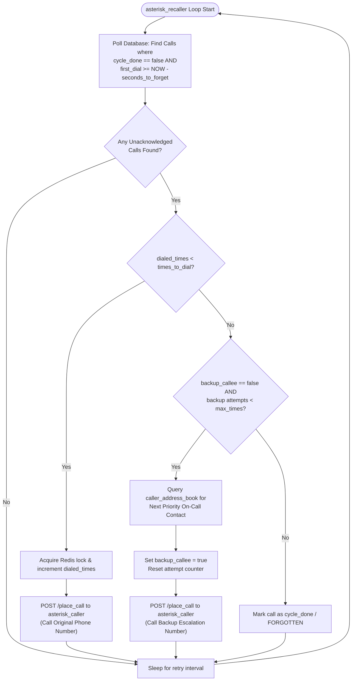
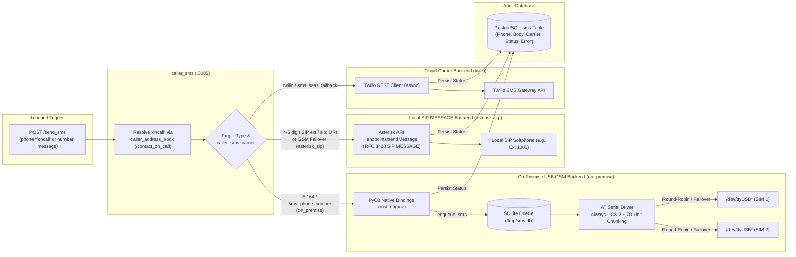
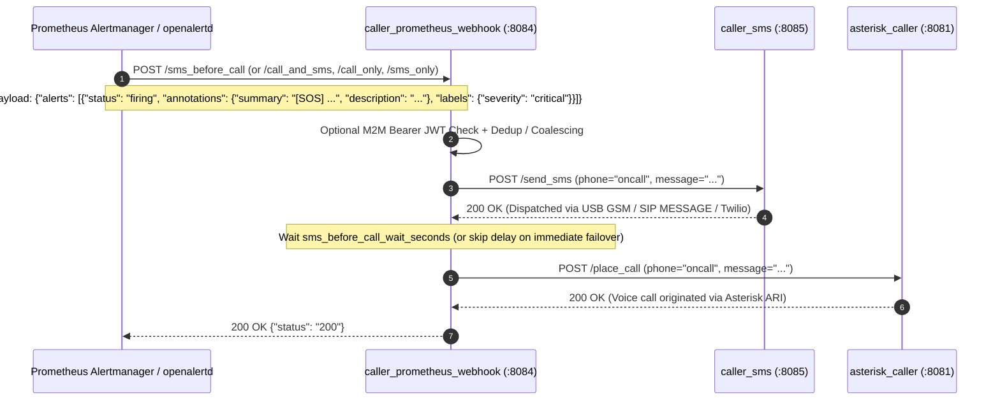
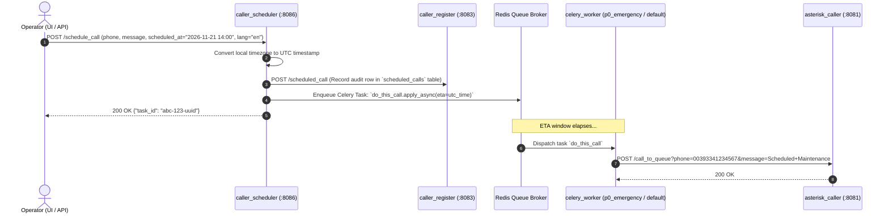
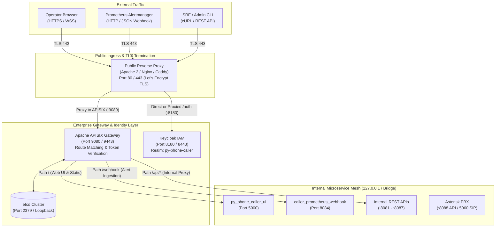
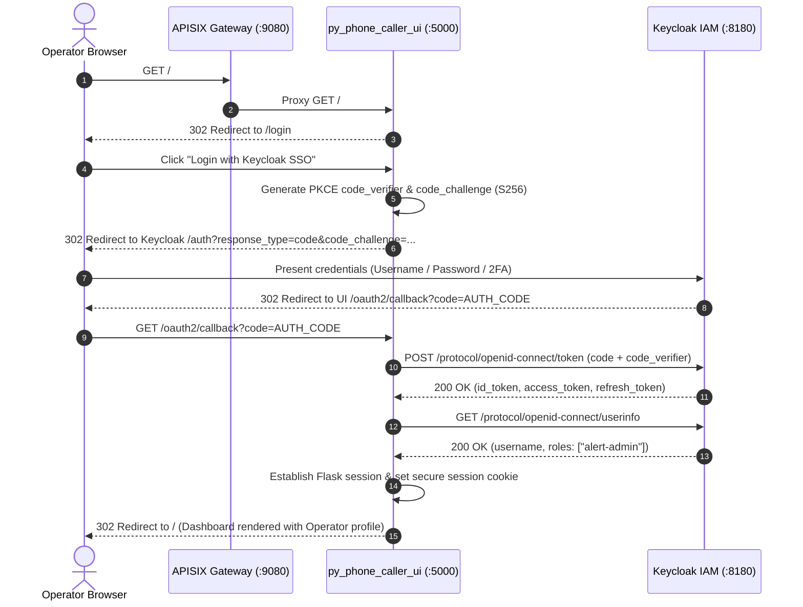
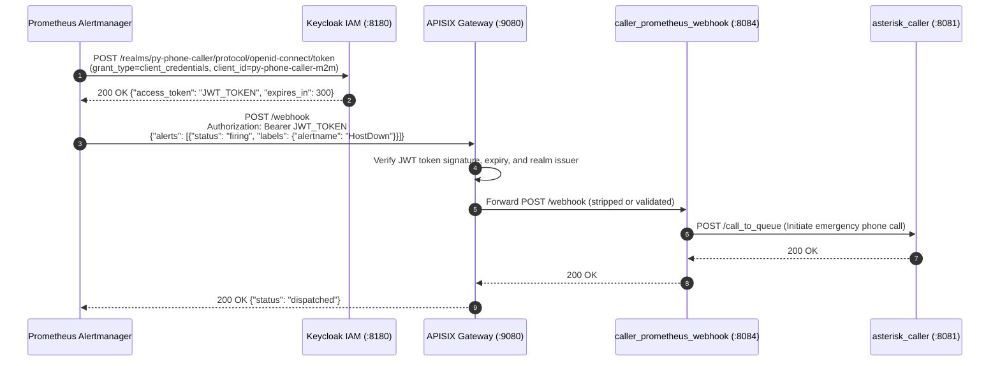

# 🏛️ py-phone-caller Architecture & Call Flows Guide

This document provides the technical architecture and sequence flow specification for **py-phone-caller** and its decentralized **OpenAlert (`openalertd`)** mesh bridge.

---

## 📑 Table of Contents

1. [High-Level Platform Architecture](#1-high-level-platform-architecture)
2. [Domain-Driven Data & Service Boundaries](#2-domain-driven-data--service-boundaries)
3. [The Core Call Lifecycle & Asterisk ARI Pipeline](#3-the-core-call-lifecycle--asterisk-ari-pipeline)
4. [Real-Time DTMF Acknowledgment & Interactive Dialplan Flow](#4-real-time-dtmf-acknowledgment--interactive-dialplan-flow)
5. [Intelligent Recaller & Backup Contact Escalation Flow](#5-intelligent-recaller--backup-contact-escalation-flow)
6. [Dual-Channel SMS & SIP MESSAGE Architecture (USB GSM, Asterisk SIP & Twilio)](#6-dual-channel-sms--sip-message-architecture-usb-gsm-asterisk-sip--twilio)
7. [Prometheus Alertmanager & OpenAlert Webhook Pipeline](#7-prometheus-alertmanager--openalert-webhook-pipeline)
8. [Scheduled Calls & Background Celery Worker Pipeline](#8-scheduled-calls--background-celery-worker-pipeline)
9. [Air-Gapped & Offline Architecture Principles](#9-air-gapped--offline-architecture-principles)
10. [Enterprise API Gateway & Keycloak IAM Ingress Architecture](#10-enterprise-api-gateway--keycloak-iam-ingress-architecture)
11. [OIDC Single Sign-On (SSO) & M2M Token Authentication Sequence Flows](#11-oidc-single-sign-on-sso--m2m-token-authentication-sequence-flows)

---

## 1. High-Level Platform Architecture

**py-phone-caller** is structured as 11 decoupled Python 3.14 microservices interacting over asynchronous HTTP REST APIs, Asterisk ARI WebSockets, Celery priority queues, and PostgreSQL/Redis stores—optionally paired with **`openalertd`** (native Rust field mesh daemon) for off-grid LoRa RF, BitChat BLE, `/sos` Captive Portal, and Nostr (`NIP-ALERT`) alerting.

---

## 2. Domain-Driven Data & Service Boundaries

Each stateful service in `py-phone-caller` encapsulates its specific business domain and exposes `/health`, `/healthz`, `/live`, dependency-aware `/ready`, `/metrics`, and OpenAPI `/docs`:

| Service | Domain Responsibility | Owned Database Tables | Primary HTTP Endpoints |
| :--- | :--- | :--- | :--- |
| **`caller_register`** | Central call registry, state tracker, and Piccolo ORM migration engine | `calls` `scheduled_calls` `asterisk_ws_events` `dead_letter_queue` | `POST /register_call` `POST /msg` `POST /scheduled_call` `GET /heard` `GET /ack` |
| **`caller_address_book`** | Dual-channel contact directory (`phone_number` + `sms_phone_number`) and time-based on-call availability | `address_book` | `POST /contact_add` `PUT /contact_modify/{id}` `DELETE /contact_delete` `GET /contact_on_call` `GET /contacts_export_csv` `POST /contacts_import_csv` |
| **`caller_sms`** | Smart dual-channel SMS & RFC 3428 SIP `MESSAGE` dispatch, inbound ACK correlation, and delivery tracking | `sms` | `POST /send_sms` `GET /get_sms` `POST /sms/inbound` |
| **`py_phone_caller_ui`** | Multilingual Flask-Babel (RTL) operator console, live TTS preview, diagnostics, auth, and audit reporting | `users` | `GET /` `GET /calls` `GET /address_book` `GET /sms` `POST /login` `GET /oauth2/login` |
| **`generate_audio`** | Strategy-pattern multi-engine offline TTS synthesis (Kokoro, Silero, Piper, MMS) & cloud fallbacks | *Stateless (Language-Scoped Audio Cache)* | `POST /make_audio` `GET /is_audio_ready` `GET /languages` `GET /audio/{filename}` |
| **`asterisk_caller`** | Call placement queue, Asterisk ARI originate client, ARI Circuit Breaker, and playback bridge | *Stateless (Async Worker Queue)* | `POST /call_to_queue` `POST /place_call` `POST /play` |
| **`caller_prometheus_webhook`** | Alertmanager & OpenAlert webhook ingestion, M2M Bearer JWT verification, deduplication, and coalescing | *Stateless (Dedup / Coalescing Buffer)* | `POST /call_only` `POST /sms_only` `POST /sms_before_call` `POST /call_and_sms` |

---

## 3. The Core Call Lifecycle & Asterisk ARI Pipeline

The following sequence diagram illustrates what happens from the moment an alert arrives until the synthesized voice message is played to the receiver over the telephony network (PSTN/SIP trunk or local SIP extension such as `1000`):

> [!NOTE]
> **`asterisk_caller` ARI Circuit Breaker**: If Asterisk ARI suffers repeated timeouts or connection errors, the built-in Circuit Breaker trips to `OPEN` state and returns HTTP `503 Service Unavailable` immediately to protect upstream workers until PBX connectivity recovers.

---

## 4. Real-Time DTMF Acknowledgment & Interactive Dialplan Flow

When the call is in progress, the operator can interact with the call using their phone keypad:

---

## 5. Intelligent Recaller & Backup Contact Escalation Flow

The `asterisk_recaller` background service (protected by distributed Redis locks via `py_phone_caller_utils.redis_lock`) ensures no emergency call goes unhandled:

---

## 6. Dual-Channel SMS & SIP MESSAGE Architecture (USB GSM, Asterisk SIP & Twilio)

Each Address Book contact supports **dual-channel destinations**:
- **`phone_number`** *(required)*: Voice/SIP destination (either a local 4–6 digit SIP extension like `1000`, a SIP URI, or a full E.164 PSTN number).
- **`sms_phone_number`** *(optional)*: Dedicated cellular SMS number (e.g., `00393341234567`).

When `caller_sms` receives `POST /send_sms` (including `phone=oncall`), its `SmsDispatchService` automatically routes messages across three carriers:

### Smart Routing & Failover Rules
1. **`phone=oncall` Dual-Channel Resolution**: `caller_sms` fetches `(sms_phone_number, phone_number)` from `caller_address_book` (`GET /contact_on_call`).
   - If `sms_phone_number` is populated, cellular SMS is dispatched via the configured carrier (`on_premise` USB GSM modem or `twilio`).
   - If cellular GSM delivery fails (or no `sms_phone_number` is configured) and `phone_number` is a local SIP extension (`4–6` digits or `sip:`/`pjsip:` URI), `caller_sms` automatically falls back to **RFC 3428 SIP `MESSAGE`** via Asterisk ARI (`asterisk_sip`) so local softphones (e.g., Linphone on Extension `1000`) still receive the text alert immediately.
2. **Always-UCS-2 UTF-8 Encoding & Multipart Chunking**:
   - In both `py_phone_caller_utils` (`rust_engine`) and `openalertd`, on-premise USB GSM modems **always** transmit SMS using **UCS-2 16-bit Unicode encoding** (`AT+CSCS="UCS2"`, `AT+CSMP=17,167,0,8`, hex-encoded UTF-16BE destination and payload). This guarantees that brackets (`[SOS]`), accents (`ù`, `é`, `ñ`), symbols, and non-Latin scripts render cleanly without GSM-7 charset corruption across different cellular modems.
   - Messages longer than **70 UTF-16 code units** are automatically split into numbered multipart segments (`(1/N) ...`) on clean UTF-16 boundaries without ever splitting surrogate pairs (such as emojis).
3. **Inbound SMS Acknowledgment (`POST /sms/inbound`)**: Incoming SMS replies containing ACK tokens are correlated against active calls in PostgreSQL (using Redis `call_mutex` locking) to acknowledge incidents remotely.

---

## 7. Prometheus Alertmanager & OpenAlert Webhook Pipeline

The `caller_prometheus_webhook` service (`:8084`) ingests standard Prometheus Alertmanager JSON payloads from both IT monitoring systems and **`openalertd`** field gateways (LoRa RF, BitChat BLE, `/sos` Captive Portal, Nostr). Setting `prometheus_webhook_receivers = ["oncall"]` dynamically routes alerts through the Address Book.

---

## 8. Scheduled Calls & Background Celery Worker Pipeline

For future alerts, maintenance reminders, and emergency priority preemption:

- **Priority Routing & DLQ**: Urgent dispatches can preempt standard scheduled traffic via the `p0_emergency` Celery queue; permanently failing tasks are isolated into `telephony.dlq` and logged in the PostgreSQL `dead_letter_queue` table for operator forensics.

---

## 9. Air-Gapped & Offline Architecture Principles

**py-phone-caller** and **OpenAlert** are validated for strict 100% air-gapped operation (including physical ARM64 appliances such as Orange Pi 5 Plus RK3588 with `systemd` `IPAddressDeny=any` enforcement):

1. **Zero Runtime CDNs**: The Web UI bundles Bootstrap and FontAwesome assets locally under `src/py_phone_caller_ui/static/` and serves `/api/docs` using same-origin service OpenAPI JSON links with zero external CDNs or telemetry calls. When `PPC_OFFLINE=1` is set in strict air-gapped deployments, `/docs` returns a static `503` offline page while `/api/docs` renders HTTP `200` as an offline portal linking only local JSON specs without external Swagger UI CDN scripts.
2. **Pre-Packaged Offline Neural TTS Models**: Weights for **Kokoro-82M**, **Silero V3**, **Piper ONNX**, and **Facebook MMS** are pre-downloaded into `pre_trained_models/` and discovered locally via `GET /languages`. Speech synthesis runs 100% on local CPUs (x86_64 and ARM64) with zero runtime Hugging Face or PyPI traffic.
3. **Deterministic UV Locking & Offline Bundles**: All Python 3.14 dependencies are locked in a single root `uv.lock`. Native Ansible air-gapped deployments install exclusively from local wheel bundles, signed `file:` APT mirrors, and pre-built `openalertd` / `rust_engine` binaries (see [`deploy/docs/09-arm64-appliance-and-airgapped-deployment.md`](../deploy/docs/09-arm64-appliance-and-airgapped-deployment.md)).
4. **Off-Grid Field Ingestion & Delivery**: `openalertd` receives alerts with zero Internet via LoRa 868 MHz RF, BitChat BLE (with BlueZ/Spreadtrum HCI self-healing), and the `OpenAlert-SOS` Wi-Fi Captive Portal (`/sos` + offline SVG CAPTCHA), then triggers local Asterisk 22 voice calls (e.g., local SIP Extension `1000`) and always-UCS-2 USB GSM modem SMS.
5. **Local Telemetry & Storage**: OpenTelemetry spans and Prometheus `/metrics` export strictly over private LAN/loopback endpoints.

---

## 10. Enterprise API Gateway & Keycloak IAM Ingress Architecture

In production environments, direct exposure of internal microservice ports (`8081`–`8087`, `5000`) is prohibited. Instead, incoming user and machine traffic passes through an enterprise perimeter ingress layer composed of **Apache APISIX** and **Keycloak IAM**:

### Key Security Guardrails:
1. **Network Boundary**: Internal service ports (5000, 8081-8087) bind to `0.0.0.0` or bridge IPs, but are strictly shielded from public routing by host packet filters (`ufw` / `firewalld`).
2. **Reverse Proxy Offloading**: Public TLS is terminated either by Apache 2 / Nginx / Caddy at ports 80/443, proxying to APISIX on port 9080 with proper `X-Forwarded-For` and `X-Forwarded-Proto` headers.
3. **Role-Based Access Control (RBAC)**: Keycloak realm `py-phone-caller` manages 3 distinct realm roles:
   - `alert-admin`: Full access to user management, phone configuration, and alert escalation.
   - `alert-operator`: Can view live calls, acknowledge alerts, and trigger manual notifications.
   - `alert-viewer`: Read-only access to call histories and audit logs.

---

## 11. OIDC Single Sign-On (SSO) & M2M Token Authentication Sequence Flows

### 11.1 Web UI OpenID Connect (OIDC) Flow with PKCE

For human operators logging into the management portal:

> [!NOTE]
> If Keycloak is unreachable, operators can still log in using the **Local Emergency Fallback** form directly on `/login`, authenticating against the local PostgreSQL `users` table.

### 11.2 Machine-to-Machine (M2M) Alert Ingestion Flow

For automated monitoring systems (e.g. Prometheus Alertmanager) pushing incident payloads:

