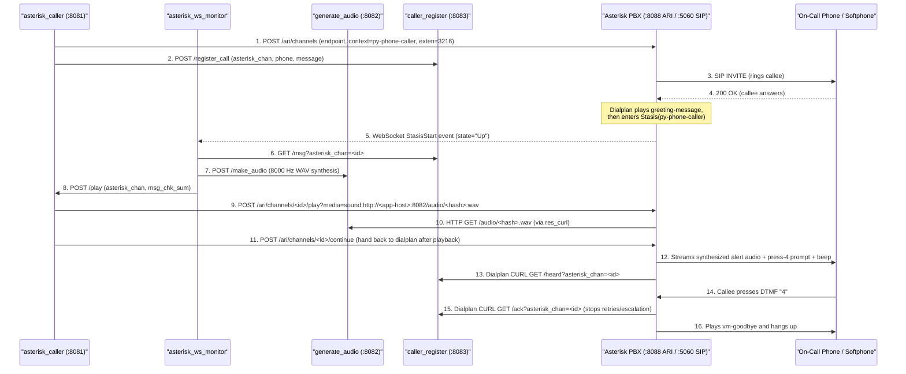

# Asterisk PBX Configuration & Examples (Native Linux)

This guide shares the complete, production-tested **Asterisk PBX (18 / 20 / 21 / 22)** configuration used by **py-phone-caller** so Open Source operators can deploy, customize, or integrate their own standalone Asterisk server on any Linux distribution.

All secret values in the examples below use the placeholder `<PASSWORD>` (and `<SIP_USERNAME>` / `<SIP_CONTACT_USER>` for trunk accounts). Replace them with strong, unique credentials stored in `.secrets.toml`, Kubernetes `Secret` manifests, or Ansible Vault.

> [!TIP]
> **Using FreePBX GUI or Automated Ansible Instead?**
> - For visual GUI screenshots on **FreePBX**, see the companion [FreePBX & Asterisk GUI Setup Guide](freepbx-asterisk-setup-guide.md).
> - For fully automated, idempotent Asterisk 22 provisioning on **Debian 13**, **Ubuntu 26.04 LTS**, **Rocky Linux 10**, and **AlmaLinux 10**, see [02. Native Ansible Deployment](../deploy/docs/02-ansible-deployment.md) and the [Asterisk Package Providers Reference](../deploy/ansible/docs/asterisk-provider.md).

---

## Table of Contents

1. [How py-phone-caller Interacts with Asterisk](#1-how-py-phone-caller-interacts-with-asterisk)
2. [Validated Asterisk Releases & Linux Package Providers](#2-validated-asterisk-releases--linux-package-providers)
3. [Non-Destructive Partial `#include` File Layout](#3-non-destructive-partial-include-file-layout)
4. [Complete `/etc/asterisk/` Configuration Examples](#4-complete-etcasterisk-configuration-examples)
    - [4.1 Built-in HTTP & WebSocket Server (`http.conf`)](#41-built-in-http--websocket-server-httpconf)
    - [4.2 Asterisk REST Interface (`ari.conf` & `ari_py_phone_caller.conf`)](#42-asterisk-rest-interface-ariconf--ari_py_phone_callerconf)
    - [4.3 PJSIP Transport, VoIP Trunk & Local Extensions (`pjsip_py_phone_caller.conf`)](#43-pjsip-transport-voip-trunk--local-extensions-pjsip_py_phone_callerconf)
    - [4.4 Stasis, TTS Playback & DTMF `4` ACK Dialplan (`extensions_py_phone_caller.conf`)](#44-stasis-tts-playback--dtmf-4-ack-dialplan-extensions_py_phone_callerconf)
    - [4.5 Optional Private IAX2 Extension (`iax.conf` & `iax_py_phone_caller.conf`)](#45-optional-private-iax2-extension-iaxconf--iax_py_phone_callerconf)
    - [4.6 Required Modules & Hardened Allowlist (`modules.conf`)](#46-required-modules--hardened-allowlist-modulesconf)
5. [Audio Prompts, Codec Format & SELinux Policies](#5-audio-prompts-codec-format--selinux-policies)
6. [Matching `py-phone-caller` Configuration (`settings.toml` & `.secrets.toml`)](#6-matching-py-phone-caller-configuration-settingstoml--secretstoml)
7. [CLI Verification, Softphone Testing & Troubleshooting](#7-cli-verification-softphone-testing--troubleshooting)

---

## 1. How `py-phone-caller` Interacts with Asterisk

Understanding the exact runtime handshake between the Python microservices and Asterisk makes troubleshooting effortless:



In addition to voice calls, **`caller_sms` (`:8085`)** can also dispatch instant **RFC 3428 SIP `MESSAGE`** text alerts to local PJSIP extensions (such as `1000` or `2500`) via `PUT /ari/endpoints/PJSIP/<exten>/sendMessage`.

---

## 2. Validated Asterisk Releases & Linux Package Providers

`py-phone-caller` works with standard **Asterisk 18, 20, 21, and 22** installations. Across our automated compliance matrix, the following native Linux package providers are continuously validated:

| Platform | Provider Route | Validated Package Version | Notes |
| :--- | :--- | :--- | :--- |
| **Ubuntu 26.04 LTS** (`x86_64` / `arm64`) | Official `ubuntu/universe` APT (`distro`) | `1:22.5.2~dfsg+~cs6.15.60671435-1` | Enable `universe` repository; includes `asterisk` and `asterisk-core-sounds-en-wav`. |
| **Debian 13 (`trixie`)** (`x86_64` / `arm64`) | Signed AllStarLink APT (`allstarlink`) | `2:22.10.1+asl3-3.10.8-1.deb13` | Debian 13 lacks an official `asterisk` package in `main`; install `asl3-asterisk` with radio/`app_rpt` modules disabled via `autoload=no`. |
| **Rocky Linux 10 & AlmaLinux 10** (`x86_64`) | Signed Tucny EL10 RPM (`tucny`) | **`22.9.0-1.el10`** (`sounds` `1.6.1-1.el10`) | Runs with **SELinux Enforcing**. Pin `22.9.0-1.el10` (avoid upstream `22.10.1`–`22.12.0` EL10 builds due to an upstream `stasis_app_claim_channel` symbol mismatch in `res_ari_events.so`). |
| **External Asterisk / FreePBX** | Existing PBX (`stack_deploy_asterisk: false`) | Asterisk `18+` / `20 LTS` / `22 LTS` | Connect over LAN/VPN via HTTP/HTTPS ARI (`:8088` / `:8089`). |

---

## 3. Non-Destructive Partial `#include` File Layout

Instead of overwriting distribution-supplied files in `/etc/asterisk/`, we isolate all `py-phone-caller` settings in dedicated `0640` (`asterisk:asterisk`) partial files and append `#include` directives to the base files:

```text
/etc/asterisk/
├── http.conf                         # Built-in HTTP/WebSocket listener (:8088)
├── ari.conf                          # Base ARI settings + #include ari_py_phone_caller.conf
├── ari_py_phone_caller.conf          # Dedicated [py-phone-caller] ARI user (0640)
├── pjsip.conf                        # Base PJSIP config + #include pjsip_py_phone_caller.conf
├── pjsip_py_phone_caller.conf        # UDP transport, SIP trunk & local extensions (0640)
├── extensions.conf                   # Base dialplan + #include extensions_py_phone_caller.conf
├── extensions_py_phone_caller.conf   # [py-phone-caller] Stasis & DTMF "4" ACK dialplan (0640)
├── iax.conf                          # Base IAX2 config + #include iax_py_phone_caller.conf (optional)
├── iax_py_phone_caller.conf          # Optional private IAX2 extension (0640)
└── modules.conf                      # Disables legacy chan_sip.so; loads PJSIP, Stasis, ARI & CURL
```

Ensure strict ownership and permissions so SIP and ARI credentials are never world-readable:

```bash
sudo chown root:asterisk /etc/asterisk/*_py_phone_caller.conf /etc/asterisk/ari.conf /etc/asterisk/http.conf
sudo chmod 0640 /etc/asterisk/*_py_phone_caller.conf /etc/asterisk/ari.conf /etc/asterisk/http.conf
```

---

## 4. Complete `/etc/asterisk/` Configuration Examples

### 4.1 Built-in HTTP & WebSocket Server (`http.conf`)

Asterisk's built-in HTTP server powers both the REST API (`/ari/channels`, `/ari/endpoints/...`) and the Stasis WebSocket stream (`/ari/events`).

Edit `/etc/asterisk/http.conf`:

```ini
[general]
enabled = yes
; Use 127.0.0.1 when Asterisk and py-phone-caller run on the same host.
; Use your private LAN/management IP (or 0.0.0.0 behind a host firewall) when
; py-phone-caller runs in Docker, Kubernetes, or on a separate application VM.
bindaddr = 127.0.0.1
bindport = 8088
prefix =

; Optional native TLS listener (sets asterisk_http_scheme = "https", port 8089):
; tlsenable = yes
; tlsbindaddr = 0.0.0.0:8089
; tlscertfile = /etc/asterisk/keys/asterisk.pem
; tlsprivatekey = /etc/asterisk/keys/asterisk.key
```

---

### 4.2 Asterisk REST Interface (`ari.conf` & `ari_py_phone_caller.conf`)

Ensure `/etc/asterisk/ari.conf` enables ARI globally and includes the partial file:

```ini
[general]
enabled = yes
pretty = yes
allowed_origins = *

#include ari_py_phone_caller.conf
```

Create `/etc/asterisk/ari_py_phone_caller.conf`:

```ini
[py-phone-caller]
type = user
read_only = no
password = <PASSWORD>
password_format = plain
```

> [!NOTE]
> If you prefer storing a cryptographically hashed password in `ari_py_phone_caller.conf`, run `asterisk -rx "ari mkpasswd <PASSWORD>"` on the PBX, set `password_format = crypt`, and paste the generated `$6$...` hash into `password =`. Keep the raw `<PASSWORD>` in `py-phone-caller`'s `.secrets.toml` (`asterisk_pass = "<PASSWORD>"`).

---

### 4.3 PJSIP Transport, VoIP Trunk & Local Extensions (`pjsip_py_phone_caller.conf`)

Append `#include pjsip_py_phone_caller.conf` to `/etc/asterisk/pjsip.conf` (making sure no duplicate UDP `0.0.0.0:5060` transport is already active in `pjsip.conf`):

```bash
grep -q '^#include pjsip_py_phone_caller.conf' /etc/asterisk/pjsip.conf \
  || echo '#include pjsip_py_phone_caller.conf' | sudo tee -a /etc/asterisk/pjsip.conf
```

Create `/etc/asterisk/pjsip_py_phone_caller.conf`. The example below includes:

1. **UDP SIP Transport (`[transport-udp]`)** (with commented NAT options if Asterisk sits behind a router/cloud VPC).
2. **Outbound VoIP SIP Trunk (`[py-phone-caller]`)** — modeled directly on our production configuration (compatible with providers such as Messagenet `sip.messagenet.it:5061`, VoIP.ms, OVH, Twilio Elastic SIP, or corporate SBCs). Omit this block if you only dial local LAN/VPN softphones.
3. **Local Softphone Extension `1000`** — tuned for mobile/desktop softphones (Linphone, MicroSIP, Zoiper) over LAN, WireGuard VPN, or off-grid Wi-Fi (`max_contacts=1`, `remove_existing=yes`, `qualify_frequency=0` so mobile sleep states do not mark the endpoint `Unavailable`).

```ini
; =====================================================================
; 1. SIP UDP Transport
; =====================================================================
[transport-udp]
type = transport
protocol = udp
bind = 0.0.0.0:5060
; --- Uncomment if Asterisk is behind NAT (Cloud VM / Home / Lab Router) ---
; local_net = 192.168.0.0/16
; local_net = 10.0.0.0/8
; external_media_address = 203.0.113.10
; external_signaling_address = 203.0.113.10

; =====================================================================
; 2. Outbound VoIP / PSTN SIP Trunk (e.g. Messagenet, VoIP.ms, Corporate SBC)
;    Matches settings.toml: asterisk_chan_type = "PJSIP/py-phone-caller"
; =====================================================================
[py-phone-caller]
type = registration
transport = transport-udp
outbound_auth = py-phone-caller_auth
server_uri = sip:sip.provider.example:5061
client_uri = sip:<SIP_USERNAME>@sip.provider.example:5061
contact_user = <SIP_CONTACT_USER>
retry_interval = 60
max_retries = 10
forbidden_retry_interval = 600
expiration = 3600
line = yes
endpoint = py-phone-caller

[py-phone-caller]
type = endpoint
transport = transport-udp
disallow = all
allow = ulaw,alaw
aors = py-phone-caller
outbound_auth = py-phone-caller_auth
from_domain = sip.provider.example
from_user = <SIP_USERNAME>
t38_udptl = no
t38_udptl_ec = none
fax_detect = no
trust_id_inbound = no
t38_udptl_nat = no
direct_media = no
rewrite_contact = yes
rtp_symmetric = yes
message_context = incoming
dtmf_mode = auto

[py-phone-caller_auth]
type = auth
auth_type = userpass
username = <SIP_USERNAME>
password = <PASSWORD>
realm = sip.provider.example

[py-phone-caller]
type = aor
qualify_frequency = 60
contact = sip:<SIP_USERNAME>@sip.provider.example:5061

[py-phone-caller]
type = identify
endpoint = py-phone-caller
match = sip.provider.example

; =====================================================================
; 3. Local PJSIP Softphone Extension 1000 (Mobile / VPN / Air-Gapped Ready)
;    Supports both ARI voice alerts and RFC 3428 SIP MESSAGE text alerts
; =====================================================================
[1000]
type = endpoint
context = py-phone-caller
disallow = all
allow = ulaw,alaw,gsm,g722
auth = 1000
aors = 1000
transport = transport-udp
rewrite_contact = yes
rtp_symmetric = yes
force_rport = yes
direct_media = no
dtmf_mode = auto

[1000]
type = auth
auth_type = userpass
username = 1000
password = <PASSWORD>

[1000]
type = aor
max_contacts = 1
remove_existing = yes
qualify_frequency = 0
```

---

### 4.4 Stasis, TTS Playback & DTMF `4` ACK Dialplan (`extensions_py_phone_caller.conf`)

Append `#include extensions_py_phone_caller.conf` to `/etc/asterisk/extensions.conf`:

```bash
grep -q '^#include extensions_py_phone_caller.conf' /etc/asterisk/extensions.conf \
  || echo '#include extensions_py_phone_caller.conf' | sudo tee -a /etc/asterisk/extensions.conf
```

Create `/etc/asterisk/extensions_py_phone_caller.conf`:

```ini
[py-phone-caller]
; ---------------------------------------------------------------------
; Primary Alerting Extension (3216)
; Invoked automatically by asterisk_caller once the callee answers.
; Replace 127.0.0.1:8083 with the py-phone-caller host IP if Asterisk
; runs on a separate machine or outside Docker/Kubernetes.
; ---------------------------------------------------------------------
exten => 3216,1,NoOp(Py-Phone-Caller Alert Start)
 same => n,Playback(greeting-message)
 same => n,Stasis(py-phone-caller)
 same => n,Set(RES=${CURL(http://127.0.0.1:8083/heard?asterisk_chan=${CHANNEL(uniqueid)})})
 same => n,Playback(press-4-for-acknowledgement)
 same => n,Playback(beep)
 same => n,Read(get,"silence/1",,,,2)
 same => n,Set(gotdigit=${ISNULL(${get})})
 same => n,GotoIf(${gotdigit}=1?20)
 same => n,GotoIf($[ ${get} = 4 ]?30)
 same => n,Goto(20)
 ; --- No ACK / Wrong Digit ---
 same => 20,Set(NOTIFYACK=2)
 same => 21,Playback(vm-goodbye)
 same => 22,Wait(1)
 same => 23,Hangup()
 ; --- Acknowledged (DTMF "4" Pressed) ---
 same => 30,Set(RES=${CURL(http://127.0.0.1:8083/ack?asterisk_chan=${CHANNEL(uniqueid)})})
 same => 31,Playback(vm-goodbye)
 same => 32,Wait(1)
 same => 33,Hangup()

; ---------------------------------------------------------------------
; Local Extension Dialing (Optional: for softphone-to-softphone or Local/ channels)
; ---------------------------------------------------------------------
exten => 1000,1,NoOp(Calling Local SIP Extension 1000)
 same => n,Dial(PJSIP/1000,30)
 same => n,Hangup()

exten => _XXXX,1,NoOp(Generic 4-Digit Local Extension Dialing for ${EXTEN})
 same => n,ExecIf($[ "${DEVICE_STATE(PJSIP/${EXTEN})}" != "INVALID" ]?Dial(PJSIP/${EXTEN},30))
 same => n,Hangup()
```

> [!IMPORTANT]
> **Why `CURL(.../heard)` and `CURL(.../ack)` Matter**  
> When `asterisk_caller` finishes queuing the synthesized WAV file via ARI, it calls `POST /ari/channels/<id>/continue` so Asterisk resumes this dialplan right after `Stasis(py-phone-caller)`. If `http://127.0.0.1:8083` (`caller_register`) is unreachable from the Asterisk host, DTMF `4` presses will **not** mark `cycle_done = true` in PostgreSQL, and `asterisk_recaller` will continue redialing according to `times_to_dial`. When Asterisk runs on a separate host from `py-phone-caller`, replace `127.0.0.1:8083` with the reachable IP/hostname of `caller_register`.

---

### 4.5 Optional Private IAX2 Extension (`iax.conf` & `iax_py_phone_caller.conf`)

For private/loopback or LAN IAX2 softphones (for example extension `2600` on UDP `4569`), configure `[general]` in `/etc/asterisk/iax.conf`:

```ini
[general]
bindaddr = 127.0.0.1
bindport = 4569

#include iax_py_phone_caller.conf
```

And create `/etc/asterisk/iax_py_phone_caller.conf`:

```ini
[2600]
type = friend
host = dynamic
secret = <PASSWORD>
context = py-phone-caller
requirecalltoken = yes
qualify = no
disallow = all
allow = ulaw,alaw,gsm
```

---

### 4.6 Required Modules & Hardened Allowlist (`modules.conf`)

Whether you use `autoload = yes` (standard Ubuntu/Debian distro default) or a hardened `autoload = no` profile (used on AllStarLink Debian 13 and Tucny Rocky/AlmaLinux 10), verify two critical rules in `/etc/asterisk/modules.conf`:

1. **Disable deprecated `chan_sip.so`** (`noload => chan_sip.so`) so it never competes with `chan_pjsip.so` for UDP port `5060`.
2. **Ensure CURL, WAV, WebSocket, Stasis, ARI, and PJSIP modules are loaded**:
    - `func_curl.so` & `res_curl.so` — required both for `${CURL(...)}` (`heard`/`ack` callbacks) **and** for Asterisk ARI to stream `sound:http://<generate_audio>:8082/audio/<hash>.wav`!
    - `format_wav.so`, `format_pcm.so`, `codec_ulaw.so`, `codec_alaw.so` — required for 8000 Hz 16-bit PCM WAV playback over G.711 channels.
    - `res_http_websocket.so`, `res_websocket_client.so`, `app_stasis.so`, `res_stasis*.so`, `res_ari*.so` — required for ARI control and `asterisk_ws_monitor`.
    - `chan_pjsip.so`, `res_pjsip*.so`, and `res_pjsip_messaging.so` — required for SIP calls and RFC 3428 SIP `MESSAGE` text delivery.

<details>
<summary><strong>Click to expand our full hardened <code>/etc/asterisk/modules.conf</code> (<code>autoload=no</code>) example</strong></summary>

```ini
; Hardened non-radio PBX module allowlist (Asterisk 22)
[modules]
autoload = no

; Uncomment these 5 lines on Rocky Linux 10 / AlmaLinux 10 (Tucny RPMs):
; load = res_speech.so
; load = res_geolocation.so
; load = res_agi.so
; load = res_statsd.so
; load = res_crypto.so

load = pbx_config.so
load = app_dial.so
load = app_playback.so
load = app_read.so
load = app_stack.so
load = app_exec.so
load = app_verbose.so
load = func_curl.so
load = res_curl.so
load = func_logic.so
load = func_channel.so
load = func_strings.so
load = func_db.so
load = func_devstate.so
load = codec_ulaw.so
load = codec_alaw.so
load = codec_gsm.so
load = codec_g722.so
load = format_pcm.so
load = format_wav.so
load = format_gsm.so
load = res_rtp_asterisk.so
load = res_timing_timerfd.so
load = bridge_simple.so
load = bridge_softmix.so
load = bridge_native_rtp.so
load = bridge_holding.so
load = res_sorcery_config.so
load = res_sorcery_memory.so
load = res_sorcery_astdb.so
load = res_sorcery_memory_cache.so
load = res_pjproject.so
load = res_pjsip.so
load = res_pjsip_acl.so
load = res_pjsip_authenticator_digest.so
load = res_pjsip_outbound_authenticator_digest.so
load = res_pjsip_endpoint_identifier_ip.so
load = res_pjsip_endpoint_identifier_user.so
load = res_pjsip_endpoint_identifier_anonymous.so
load = res_pjsip_registrar.so
load = res_pjsip_session.so
load = res_pjsip_sdp_rtp.so
load = res_pjsip_pubsub.so
load = res_pjsip_messaging.so
load = res_pjsip_dialog_info_body_generator.so
load = res_pjsip_pidf_body_generator.so
load = res_pjsip_xpidf_body_generator.so
load = res_pjsip_notify.so
load = res_pjsip_refer.so
load = res_pjsip_header_funcs.so
load = res_pjsip_dtmf_info.so
load = res_pjsip_rfc3326.so
load = res_pjsip_outbound_registration.so
require = chan_pjsip.so
load = res_http_websocket.so
load = res_websocket_client.so
load = res_stasis.so
load = res_stasis_answer.so
load = res_stasis_device_state.so
load = res_stasis_playback.so
load = res_stasis_recording.so
load = res_stasis_snoop.so
require = app_stasis.so
load = res_ari_model.so
load = res_ari.so
load = res_ari_applications.so
require = res_ari_asterisk.so
load = res_ari_bridges.so
load = res_ari_channels.so
load = res_ari_device_states.so
load = res_ari_endpoints.so
load = res_ari_events.so
load = res_ari_playbacks.so
load = res_ari_recordings.so
load = res_ari_sounds.so
noload => chan_sip.so
```

</details>

---

## 5. Audio Prompts, Codec Format & SELinux Policies

### Custom Voice Prompts (`greeting-message.wav` & `press-4-for-acknowledgement.wav`)

The `[py-phone-caller]` dialplan plays two short static prompts bundled in this repository under [`deploy/ansible/roles/asterisk_py_phone_caller/files/sounds/`](../deploy/ansible/roles/asterisk_py_phone_caller/files/sounds/) plus standard Asterisk core prompts (`beep.wav`, `vm-goodbye.wav`):

- **Debian / Ubuntu sounds path**: `/usr/share/asterisk/sounds/en/` (or `/var/lib/asterisk/sounds/en/`)
- **Rocky / AlmaLinux (Tucny RPM) sounds path**: `/usr/share/asterisk/sounds/`

Copy the two custom prompt files into your Asterisk sounds directory:

```bash
# Debian / Ubuntu example:
sudo cp deploy/ansible/roles/asterisk_py_phone_caller/files/sounds/*.wav /usr/share/asterisk/sounds/en/
sudo chown asterisk:asterisk /usr/share/asterisk/sounds/en/*.wav
sudo chmod 0644 /usr/share/asterisk/sounds/en/*.wav
```

If you record your own custom localized prompts, convert them to **8000 Hz, mono, 16-bit signed PCM WAV** so Asterisk plays them natively without transcoding failures:

```bash
ffmpeg -i my-custom-greeting.mp3 -ar 8000 -ac 1 -c:a pcm_s16le greeting-message.wav
```

### SELinux Enforcing (`Rocky Linux 10` / `AlmaLinux 10` / `RHEL`)

On Enterprise Linux systems with **SELinux Enforcing**, Asterisk (`asterisk_t`) is confined from initiating outbound HTTP connections to non-standard TCP ports unless those ports carry the `http_port_t` SELinux label. Permit TCP ports **`8082`** (`generate_audio`) and **`8083`** (`caller_register`):

```bash
sudo semanage port -a -t http_port_t -p tcp 8082 || sudo semanage port -m -t http_port_t -p tcp 8082
sudo semanage port -a -t http_port_t -p tcp 8083 || sudo semanage port -m -t http_port_t -p tcp 8083
```

---

## 6. Matching `py-phone-caller` Configuration (`settings.toml` & `.secrets.toml`)

Configure `py-phone-caller` so its ARI credentials, dialplan target (`py-phone-caller` / `3216`), and channel dialing pattern match your `/etc/asterisk/` configuration.

### `settings.toml` (Non-Secret Settings)

```toml
[commons]
asterisk_user = "py-phone-caller"
asterisk_host = "127.0.0.1"       # Or your PBX IP (e.g. "192.168.1.50")
asterisk_web_port = "8088"
asterisk_http_scheme = "http"     # Set "https" if using tlsbindaddr 8089

[asterisk_call]
asterisk_ari_channels = "ari/channels"
asterisk_ari_play = "play?media=sound"
asterisk_context = "py-phone-caller"
asterisk_extension = "3216"
asterisk_caller_id = "Py-Phone-Caller"

# Choose the channel dialing mode matching your PBX setup:
#   Mode A — External SIP Trunk ([py-phone-caller] in pjsip_py_phone_caller.conf):
asterisk_chan_type = "PJSIP/py-phone-caller"
#   Mode B — Direct Local PJSIP Softphone Extensions (e.g. phone = "1000"):
# asterisk_chan_type = "PJSIP/{phone}"
#   Mode C — Route via Dialplan [py-phone-caller] (supports mixed PJSIP + IAX2 _XXXX):
# asterisk_chan_type = "Local/{phone}@py-phone-caller"

[asterisk_ws_monitor]
asterisk_stasis_app = "py-phone-caller"

[generate_audio]
# IMPORTANT: If Asterisk runs on a DIFFERENT host or outside Docker/K8s, set
# generate_audio_host to an IP/hostname reachable BY the Asterisk server!
generate_audio_http_scheme = "http"
generate_audio_host = "127.0.0.1"
generate_audio_port = 8082
tts_engine = "kokoro_tts"

[call_register]
call_register_http_scheme = "http"
call_register_host = "127.0.0.1"
call_register_port = "8083"
```

### `.secrets.toml` (Credentials — Mode `0600`, Never Committed)

```toml
[commons]
asterisk_pass = "<PASSWORD>"

[database]
db_password = "<PASSWORD>"

[py_phone_caller_ui]
secret_key = "<PASSWORD>"
ui_admin_password = "<PASSWORD>"
```

---

## 7. CLI Verification, Softphone Testing & Troubleshooting

After saving your files, restart or reload Asterisk and verify each subsystem step by step:

```bash
# 1. Restart Asterisk cleanly so http.conf, modules.conf, and PJSIP transports bind
sudo systemctl restart asterisk

# 2. Check HTTP server & ARI status
sudo asterisk -rx "http show status"
sudo asterisk -rx "ari show status"
sudo asterisk -rx "ari show users"

# 3. Check PJSIP transports, trunk registration, and local extension 1000
sudo asterisk -rx "pjsip show transports"
sudo asterisk -rx "pjsip show registrations"
sudo asterisk -rx "pjsip show endpoints"

# 4. Verify dialplan context [py-phone-caller]
sudo asterisk -rx "dialplan show py-phone-caller"

# 5. Once asterisk_ws_monitor is running, confirm the Stasis app is registered!
sudo asterisk -rx "ari show apps"
# Expected: py-phone-caller shows as registered
```

### Test ARI & Place a Verification Call / SIP `MESSAGE`

```bash
# 1. Verify authenticated HTTP ARI response (returns HTTP 200 JSON)
curl -fsS -u 'py-phone-caller:<PASSWORD>' \
  http://127.0.0.1:8088/ari/asterisk/info | jq .system.version

# 2. Register Linphone (or MicroSIP) to sip:1000@<pbx-ip>:5060 with <PASSWORD>,
#    then trigger an end-to-end voice alert (press "4" when prompted!):
curl -X POST "http://127.0.0.1:8081/call_to_queue" \
  -H "Content-Type: application/json" \
  -d '{"phone": "1000", "message": "Hello from the Open Source community test alert."}'

# 3. Send an RFC 3428 SIP MESSAGE text alert to extension 1000 via caller_sms:
curl -X POST "http://127.0.0.1:8085/send_sms" \
  -H "Content-Type: application/json" \
  -d '{"phone": "1000", "message": "Test SIP MESSAGE alert via Asterisk PJSIP."}'
```

### Common Troubleshooting Reference

| Symptom | Root Cause | Resolution |
| :--- | :--- | :--- |
| **`HTTP 401 Unauthorized` on ARI** | Mismatch between `ari_py_phone_caller.conf` `password` and `.secrets.toml` `asterisk_pass`. | Verify `[py-phone-caller]` user via `asterisk -rx "ari show user py-phone-caller"` and confirm `.secrets.toml` matches `<PASSWORD>`. |
| **`500 Endpoint not found` or `Allocation failed`** | `asterisk_chan_type` does not match the endpoint name, or `chan_pjsip.so` failed to bind `:5060`. | For local extension `1000`, use `asterisk_chan_type = "PJSIP/{phone}"` (or `"Local/{phone}@py-phone-caller"`). For an external trunk `[py-phone-caller]`, use `"PJSIP/py-phone-caller"`. Ensure `noload => chan_sip.so` is set. |
| **Phone rings and answers, but no TTS voice plays** | Asterisk cannot reach `generate_audio` (`:8082`), or `res_curl.so` / `format_wav.so` is missing. | Check `asterisk -rx "module show like curl"`. If Asterisk is on another host or outside Docker/K8s, set `generate_audio_host` to the host's LAN IP (not `127.0.0.1`) and allow TCP `8082` (+ SELinux `http_port_t` on EL10). |
| **Pressing DTMF `4` does not stop redials** | Asterisk dialplan `${CURL(.../ack)}` cannot reach `caller_register` (`:8083`), or `dtmf_mode` mismatch. | Update `127.0.0.1:8083` in `extensions_py_phone_caller.conf` to the `py-phone-caller` host IP, verify `dtmf_mode = auto` on the PJSIP endpoint, and allow TCP `8083` in firewall/SELinux. |
| **SIP `MESSAGE` to `1000` returns `404` / `500`** | `res_pjsip_messaging.so` is not loaded, or softphone is unregistered. | Load `res_pjsip_messaging.so` in `modules.conf` and verify `pjsip show aor 1000` shows an active `Contact:`. |
