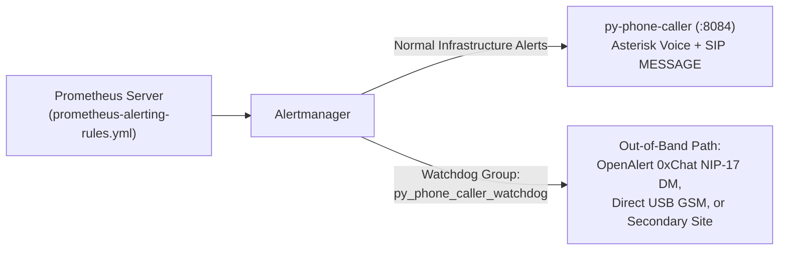

# Day-2 SRE Runbook & Self-Monitoring ("Who Watches the Watchmen?")

An emergency alerting platform is the **last line of defense** during an outage — which means its own health, backups, credential hygiene, and dead-letter queues deserve explicit operational playbooks.

---

## 1. "Who Watches the Watchmen?" Self-Monitoring Architecture

Never route alerts about an Asterisk PBX outage *solely* through that same Asterisk PBX. Use an **out-of-band secondary path** so self-monitoring alarms always reach a human operator even if SIP trunking or PostgreSQL is down:



### Turnkey Prometheus Alerting Rules

This repository ships ready-to-load self-monitoring rules in **[`deploy/dashboards/prometheus-alerting-rules.yml`](../deploy/dashboards/prometheus-alerting-rules.yml)** covering both pillars:

| Alert Rule | Metric Expression | Trigger Threshold |
| :--- | :--- | :--- |
| **`PyPhoneCallerServiceDown`** | `up{job=~"py-phone-caller.*"} == 0` | Down `> 1m` |
| **`PyPhoneCallerHighCallFailureRate`** | `rate(py_phone_caller_calls_total{status=~"failed\|error\|unavailable"}[10m])` | `> 20%` failure ratio |
| **`PyPhoneCallerZeroAcknowledgmentRate`** | `increase(py_phone_caller_calls_total[30m]) >= 5` with `0` ACKs | `5m` window |
| **`PyPhoneCallerSmsDeliveryFailures`** | `increase(py_phone_caller_sms_dispatched_total{status=~"failed\|error"}[15m])` | `>= 2` failed SMS |
| **`PyPhoneCallerTtsSynthesisSlow`** | `histogram_quantile(0.95, ...py_phone_caller_tts_duration_seconds_bucket[5m])` | p95 `> 8.0s` |
| **`OpenAlertWebhookCircuitBreakerOpen`** | `openalert_webhook_circuit_breaker_state == 2` | Open `> 1m` |
| **`OpenAlertSqliteSpoolBacklogGrowing`** | `openalert_storage_alerts_count{status="pending"} > 10` | Backlog `> 5m` |
| **`OpenAlertLoraRfLinkDegraded`** | `openalert_peering_rf_rssi_dbm < -118 or openalert_peering_rf_snr_db < -10` | Weak RF `> 10m` |

Validate rule syntax with `promtool`:

```bash
promtool check rules deploy/dashboards/prometheus-alerting-rules.yml
```

---

## 2. Backup & Point-in-Time Restore Runbook

### Automated Ansible Lifecycle Playbooks

If you deployed via Ansible (`deploy/ansible/`), use the built-in lifecycle playbooks ([`deploy/ansible/docs/lifecycle.md`](../deploy/ansible/docs/lifecycle.md)):

```bash
cd deploy/ansible

# Capture timestamped snapshot (PostgreSQL dump + config + openalertd SQLite + systemd units)
ansible-playbook -i /path/to/hosts.yml backup.yml --ask-vault-pass

# Restore from a specific backup archive
ansible-playbook -i /path/to/hosts.yml restore.yml -e "restore_archive=/var/backups/py-phone-caller/<ARCHIVE>" --ask-vault-pass
```

### Manual Online Backup (Docker / Kubernetes / DEB / RPM)

Perform consistent online backups with **zero downtime**:

```bash
BACKUP_DIR="/var/backups/py-phone-caller/$(date -u +%Y%m%dT%H%M%SZ)"
sudo mkdir -p "$BACKUP_DIR"
sudo chmod 0700 "$BACKUP_DIR"

# 1. PostgreSQL custom-format atomic dump (calls, address_book, scheduled_calls, sms, users, DLQ)
PGPASSWORD="<PASSWORD>" pg_dump -h 127.0.0.1 -U py_phone_caller -Fc py_phone_caller \
  > "$BACKUP_DIR/py_phone_caller.pgdump"

# 2. OpenAlert embedded SQLite online backup (safe while openalertd is running in WAL mode)
sqlite3 /var/lib/openalertd/openalert.db ".backup '$BACKUP_DIR/openalert.db'"

# 3. Configuration & Asterisk partial files
sudo tar -C / -czf "$BACKUP_DIR/configs.tar.gz" \
  etc/py-phone-caller \
  etc/openalertd \
  etc/asterisk/ari_py_phone_caller.conf \
  etc/asterisk/pjsip_py_phone_caller.conf \
  etc/asterisk/extensions_py_phone_caller.conf
```

To restore the PostgreSQL dump onto a replacement node:

```bash
PGPASSWORD="<PASSWORD>" pg_restore -h 127.0.0.1 -U py_phone_caller --clean --if-exists -d py_phone_caller \
  "$BACKUP_DIR/py_phone_caller.pgdump"
```

---

## 3. Zero-Downtime Credential & Secret Rotation

| Credential | Rotation Procedure |
| :--- | :--- |
| **Asterisk ARI Password** (`asterisk_pass`) | 1. Update `password = <NEW_PASSWORD>` in `/etc/asterisk/ari_py_phone_caller.conf` and run `sudo asterisk -rx "module reload res_ari.so"`.<br/>2. Update `asterisk_pass` in `.secrets.toml` (or K8s `Secret`) and restart `asterisk_caller`, `asterisk_ws_monitor`, and `caller_sms`. |
| **Local SIP Extension `1000`** | Re-run Ansible with `-e "asterisk_sip_exten_1000_rotate_password=true"` (or update `[1000]` in `pjsip_py_phone_caller.conf` and run `sudo asterisk -rx "module reload res_pjsip.so"`), then update Linphone. |
| **Web UI Admin Password** | Rotate directly in the Web UI (**Users** tab) or set `UI_USER_RESET_PASSWORD=true` + new `ui_admin_password` in `.secrets.toml`, restart `py_phone_caller_ui` once, then reset `UI_USER_RESET_PASSWORD=false`. |
| **OpenAlert Auth Hashes & Mesh Key** | Run `openalertd hash-password "<NEW_PASSWORD>"` for `[rest.auth]` / `[dashboard.auth]` / `[sos.auth]`. For `[peering] shared_key` or `[nostr.privacy] group_key`, generate a fresh 32-byte hex key via `openalertd` Web UI Tools or `openssl rand -hex 32` and roll across peers before pruning the old peer entry. |

---

## 4. Incident Triage: Dead-Letter Queue & OpenAlert Spool

### Inspecting Failed Tasks & Unacknowledged Calls (`py-phone-caller`)

1. Check service readiness probes across all ports in one sweep:

    ```bash
    for port in 5000 8081 8082 8083 8084 8085 8086 8087; do
      printf "Port %s: " "$port"
      curl -fsS "http://127.0.0.1:${port}/ready" || echo "DEGRADED"
    done
    ```

2. Query recent unacknowledged calls or dead-letter queue entries in PostgreSQL:

    ```sql
    SELECT id, phone, created_at, heard_at, acknowledge_at, cycle_done
    FROM calls
    ORDER BY created_at DESC
    LIMIT 15;

    SELECT * FROM dead_letter_queue ORDER BY created_at DESC LIMIT 10;
    ```

### Draining or Resetting Tripped OpenAlert Peers (`openalertd`)

```bash
# Inspect peer link health, RSSI/SNR, and circuit breakers
openalertd peers

# Inspect spooled alerts waiting on link recovery
openalertd spool

# Reset a tripped peer circuit breaker immediately after fixing network/radio connectivity
curl -fsS -X POST "http://127.0.0.1:8090/api/v1/peers/gateway-hub/reset"
```
